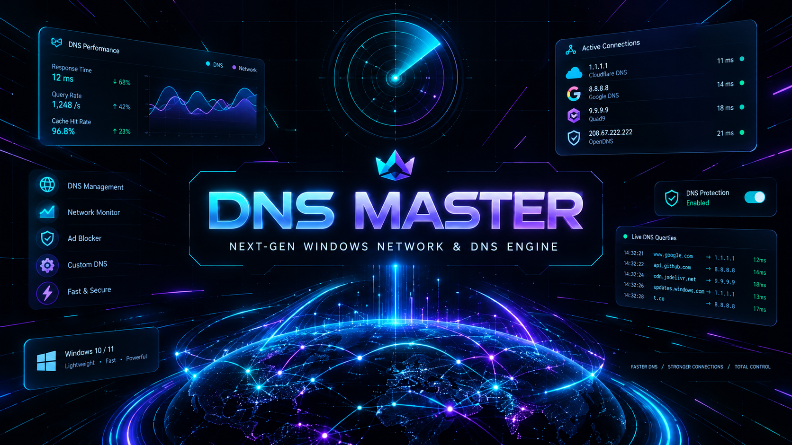
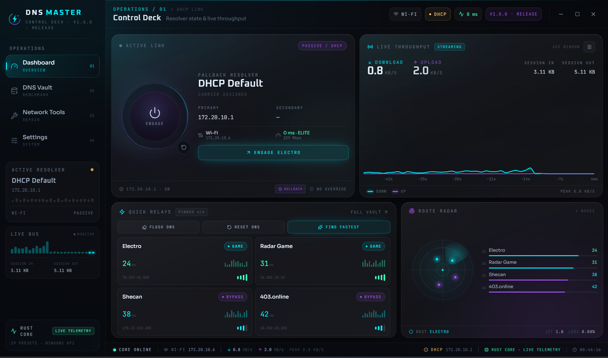

<div dir="rtl" align="right">

<div align="center">



<br />

# ⚡ Dns Master (دی‌ان‌اس مستر)

**پیشرفته‌ترین ابزار تغییر DNS، بنچمارک واقعی پورت ۵۳، تستر تحریم‌شکن و مانیتورینگ زنده ترافیک شبکه برای ویندوز ۱۰ و ۱۱**

[](./README.md)
[](./README.fa.md)

[](https://github.com/alrzfrscn/Dns-Master/releases)
[-0078D6?style=flat-square&logo=windows)](https://github.com/alrzfrscn/Dns-Master/releases)
[](https://v2.tauri.app/)
[](https://www.rust-lang.org/)
[](https://react.dev/)

<p align="center">
  <a href="https://github.com/alrzfrscn/Dns-Master/releases"><strong>⬇️ دانلود مستقیم نسخه نصبی ویندوز (.exe / .msi)</strong></a>
  ·
  <a href="./README.md"><strong>🇬🇧 English Documentation</strong></a>
  ·
  <a href="./docs/ARCHITECTURE.md"><strong>📐 معماری فنی سیستم</strong></a>
  ·
  <a href="https://github.com/alrzfrscn/Dns-Master/issues"><strong>🐞 گزارش باگ یا پیشنهاد DNS</strong></a>
</p>



</div>

---

## 🎯 چرا Dns Master؟

اکثر برنامه‌های تغییر DNS در ویندوز یا ظاهری قدیمی دارند، یا هنگام تغییر DNS پنجره سیاه `CMD` را روی صفحه می‌پرانند، و یا برای تست سرعت از پینگ معمولی (`ICMP`) استفاده می‌کنند که توسط بسیاری از سرورها مسدود شده و سرعت واقعی باز شدن سایت‌ها و بازی‌ها را نشان نمی‌دهد.

**Dns Master** با ترکیب هسته فوق‌سریع **Rust (متصل به Win32 API ویندوز)** و رابط کاربری **React 19 + Tailwind CSS** با تم تاریک شیشه‌ای/نئونی ساخته شده است تا تمام ابزارهای شبکه را بدون مصرف CPU در یک داشبورد مدرن جمع کند.

| ویژگی | ابزارهای قدیمی تغییر DNS | ⚡ Dns Master (`v1.0.0`) |
| :--- | :--- | :--- |
| **روش تست پینگ و سرعت** | پینگ ساده `ICMP` (اغلب مسدود یا غیرواقعی در شبکه‌های Anycast) | **ارسال کوئری واقعی DNS روی پورت `UDP:53`** (استاندارد RFC 1035) + محاسبه دقیق Jitter |
| **تست هوشمند تحریم‌شکن** | ندارد | **تستر زنده TLS/SNI روی پورت 443** + تشخیص آی‌پی‌های فیلترینگ (`10.10.34.x`) |
| **مانیتورینگ زنده ترافیک** | ندارد یا نیازمند پردازش سنگین | **ارتباط مستقیم با هسته ویندوز (`GetIfTable2`)** با مصرف نزدیک به صفر CPU |
| **تغییر و خواندن ایمن DNS** | اجرای کورکورانه `netsh` همراه با پرش پنجره CMD | **خواندن مستقیم از رجیستری ویندوز**، اجرای کاملاً مخفی، تایید ثبت شدن و **دکمه بازگشت (Rollback)** |
| **به‌روزرسانی لیست سرورها** | دستی و ثابت | **آپدیت آنلاین ۱-کلیکی از گیت‌هاب** + قابلیت Import/Export فایل JSON |

---

## ✨ امکانات و قابلیت‌های کلیدی

- 🔮 **رابط کاربری گیمینگ و شیشه‌ای (Dark Glassmorphism HUD):** پنجره بدون قاب `1100×720` با نمودار لحظه‌ای سرعت دانلود/آپلود، رادار پینگ و میانبرهای کیبورد (`Ctrl+1` تا `Ctrl+4`).
- 🇮🇷 **مجهز به ۳۰ سرور منتخب ایرانی و جهانی:** شامل بهترین دی‌ان‌اس‌های گیمینگ و تحریم‌شکن (**الکترو، رادار گیم، شکن، ۴۰۳، بگذر، شاتل، شلتر، وانیلا، دایناکس، هاست‌ایران، کلودفلر، گوگل، Quad9، AdGuard و...**).
- 🚀 **بنچمارک موازی و دکمه «یافتن سریع‌ترین» (Find Fastest):** تست همزمان تمام ۳۰ سرور در کمتر از ۲ ثانیه با نمایش زنده پیشرفت هر سرور و اتصال خودکار به بهترین گزینه بر اساس پینگ و جیتر.
- 🛡️ **آزمایشگاه تست تحریم‌شکن (Sanction Bypass Tester):** بررسی واقعی باز شدن ۶ سرویس حیاتی برنامه‌نویسی، هوش مصنوعی و گیمینگ (**Docker Hub, GitHub, OpenAI API, Hugging Face, Steam, EA Online**) با DNS فعلی شما.
- 🔌 **تشخیص هوشمند کارت شبکه اصلی:** شناسایی دقیق کارت شبکه فعال دارای اینترنت (`Wi-Fi`، `Ethernet` و کارت‌های مجازی VPN) و نمایش سرعت لینک، آی‌پی محلی و Gateway.
- 🔒 **محافظ نشت IPv6 (IPv6 Leak Guard):** جلوگیری از لو رفتن DNS واقعی روی اینترنت‌های دارای IPv6 بدون از کار انداختن پشته شبکه ویندوز.
- 🖥️ **مینی‌مایز در کنار ساعت ویندوز (System Tray) و اجرای خودکار:** تغییر سریع DNS، ریست به DHCP و خالی کردن کش (`Flush DNS`) تنها با کلیک راست روی آیکون کنار ساعت ویندوز.

---

## 📥 دانلود و نصب (ویندوز ۱۰ و ۱۱ نسخه ۶۴ بیتی)

۱. وارد بخش [**Releases در گیت‌هاب**](https://github.com/alrzfrscn/Dns-Master/releases) شوید.
۲. فایل نصبی **`Dns.Master_1.0.0_x64-setup.exe`** یا **`Dns.Master_1.0.0_x64_en-US.msi`** را دانلود و نصب کنید.
> **نکته درباره دسترسی Administrator:** برنامه برای نمایش ترافیک، تست پینگ، بنچمارک و حتی `Flush DNS` نیازی به دسترسی ادمین ندارد و فقط در لحظه‌ای که دکمه تغییر DNS روی کارت شبکه را می‌زنید، مجوز استاندارد ویندوز (UAC) را درخواست می‌کند.

---

## 🌐 آپدیت آنلاین لیست DNS و مشارکت در پروژه (`dns_list.json`)

شما می‌توانید در بخش **Settings → Resolver Source** یا با زدن دکمه **Sync** در بخش **DNS Vault**، آخرین لیست سرورهای DNS را به صورت آنلاین از گیت‌هاب دریافت کنید:

</div>

```text
https://raw.githubusercontent.com/alrzfrscn/Dns-Master/main/dns_list.json
```

<div dir="rtl" align="right">

### 🤝 چطور DNS جدید به لیست عمومی اضافه کنیم؟ (Pull Request)
اگر DNS جدید و پرسرعتی برای بازی یا دور زدن تحریم‌ها می‌شناسید، کافی است فایل [`dns_list.json`](./dns_list.json) را در همین ریپازیتوری ویرایش کرده و یک **Pull Request** ثبت کنید تا پس از تایید، با یک کلیک برای تمام کاربران برنامه همگام‌سازی شود! همچنین می‌توانید داخل برنامه DNSهای شخصی خودتان را با دکمه **Export JSON** خروجی بگیرید.

---

## 🛠️ ساخت و اجرا از روی سورس‌کد (ویژه توسعه‌دهندگان)

برای اجرای پروژه در محیط توسعه، به **Node.js** و **Rust Toolchain** روی ویندوز نیاز دارید:

</div>

```powershell
# ۱. نصب وابستگی‌های فرانت‌اند
npm install

# ۲. اجرای برنامه در حالت توسعه (محیط زنده دسکتاپ)
npm run tauri dev

# ۳. اجرای ۴۶ تست واحد Rust و بررسی تایپ‌اسکریپت
cargo test --manifest-path src-tauri/Cargo.toml
npm run build

# ۴. ساخت فایل‌های نصبی نهایی (.exe و .msi)
npm run tauri build
```

<div dir="rtl" align="right">

---

## ⭐ حمایت از پروژه

اگر **Dns Master** برای کاهش پینگ بازی یا رفع تحریم ابزارهای برنامه‌نویسی به کارتان آمد، خوشحال می‌شویم با دادن یک **ستاره (Star ⭐)** در بالای همین صفحه از پروژه حمایت کنید و آن را به دوستانتان معرفی کنید!

</div>
