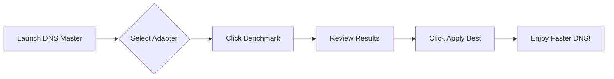
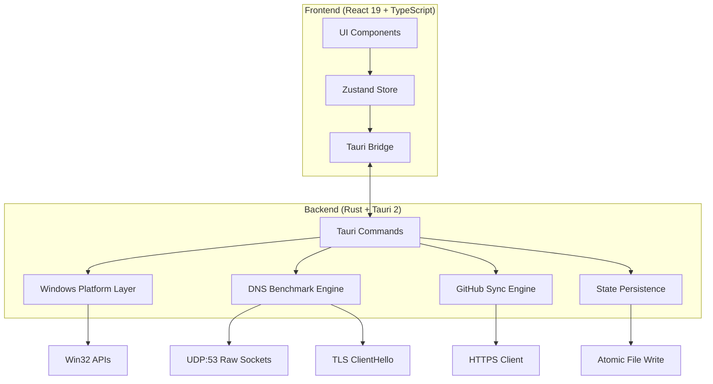

<<<<<<< HEAD
# DNS Master

<div align="center">


**A native Windows control deck for DNS resolvers — benchmark, switch, verify, and persist.**

[](https://github.com/yourusername/dns-master/actions)
[](https://github.com/yourusername/dns-master/releases)
[](LICENSE)
[](https://www.microsoft.com/windows)
[](https://tauri.app)
[](https://react.dev)
[](https://www.rust-lang.org)

[](https://github.com/yourusername/dns-master/releases/latest)
[](https://discord.gg/yourserver)
[](https://github.com/yourusername/dns-master/stargazers)

</div>

---

## ✨ Why DNS Master?

<div align="center">

| Before DNS Master | After DNS Master |
|:---:|:---:|
| 🐌 Slow, unreliable DNS | ⚡ Benchmarked, optimal resolvers |
| 🔧 Manual `netsh` commands | 🖱️ One-click apply with rollback |
| ❓ Guessing which resolver is fastest | 📊 Real-time latency, jitter & loss |
| 🌐 Sanctions blocking access | 🛡️ TLS SNI bypass verification |
| 💾 Settings lost on reboot | 🔒 Persistent across restarts |

</div>

---

## 🚀 Features

### 📡 **Live Traffic Telemetry**
Real-time per-adapter byte counters via `GetIfTable2`, streamed at 1Hz with session totals and peak tracking. No sampling daemon, no console window.

### ⚡ **Parallel DNS Benchmark**
RFC 1035 UDP:53 benchmark with bounded 15-thread sweep. Per-resolver latency, jitter, and packet loss — streamed into the table as each probe finishes.

### 🛡️ **TLS SNI Sanction Bypass Prober**
Resolves 6 real targets (Docker Hub, GitHub, OpenAI, Hugging Face, Steam, EA), rejects sinkholes and bogons, then proves port 443 with a real ClientHello carrying the correct SNI.

### 🔍 **Locale-Neutral Registry Reader**
Reads `Tcpip\Parameters\Interfaces\{GUID}` directly — no parsing of localized `netsh` output.

### 🛡️ **UAC-Safe Writer with Rollback**
Applies resolvers hidden and unelevated. Retries through UAC prompt only when Windows refuses. Verifies read-back before reporting success. Keeps previous resolver for one-click rollback.

### 💾 **Persistent State**
Custom resolvers, GitHub-synced rows, pins, settings, and rollback snapshot live in `%APPDATA%\com.dnsmaster.desktop\state.json`, written atomically.

### 🪟 **Real Windows Startup**
*Launch with Windows* toggle writes/removes `HKCU\Software\Microsoft\Windows\CurrentVersion\Run\DnsMaster`, launching with `--minimized` — no window in your face on boot.

### 📦 **System Tray & Close-to-Tray**
Left-click restores; menu offers show/hide, quick engage, DHCP reset, cache flush, and real quit. Closing window hides it when *Minimize to tray* is enabled.

### 📤 **JSON Import / Export**
Export custom and pinned resolvers as `{ "servers": [...] }` manifest. Import any local manifest through the same validator the sync uses.

### 🔔 **Desktop Notifications**
Native notices for applies, resets, and syncs when the window is in the background.

### 🔄 **GitHub Raw JSON Sync**
HTTPS-only fetch, manifest validation, merge by primary IPv4. Real measurements and pins survive a pull.

---

## 📸 Screenshots

<div align="center">

| Main Dashboard | Benchmark Panel | Settings |
|:---:|:---:|:---:|
|  |  |  |
| *Real-time traffic & resolver status* | *Parallel latency, jitter & loss* | *Resolver source, sync & preferences* |

| System Tray | Custom DNS Modal | Network Tools |
|:---:|:---:|:---:|
|  |  |  |
| *Quick actions from tray* | *Add/edit custom resolvers* | *Flush cache, reset DHCP, test connectivity* |

</div>

---

## 📦 Installation

### Option 1: Download Installer (Recommended)
1. Go to [Releases](https://github.com/yourusername/dns-master/releases/latest)
2. Download `DNS_Master_Setup_x64.exe`
3. Run installer — no admin required for user-level install

### Option 2: Portable
1. Download `dns-master_x64_portable.zip` from Releases
2. Extract anywhere
3. Run `dns-master.exe`

### Option 3: Package Managers
```powershell
# Scoop (coming soon)
scoop bucket add dns-master https://github.com/yourusername/scoop-bucket
scoop install dns-master

# Chocolatey (coming soon)
choco install dns-master

# Winget (coming soon)
winget install yourusername.dns-master
```

---

## 🎯 Quick Start



1. **Launch** DNS Master from Start Menu or tray
2. **Select** your active network adapter (top dropdown)
3. **Benchmark** — click the ▶ Benchmark button to test all resolvers
4. **Review** — sort by latency, jitter, or packet loss
5. **Apply** — click **Apply** on your chosen resolver
6. **Persist** — enable *Launch with Windows* & *Minimize to tray* in Settings

---

## 🌐 Custom Resolver List on GitHub

Host your own curated resolver list and sync it across machines.

### Create Your List

```json
{
  "version": 1,
  "servers": [
    {
      "id": "electro",
      "name": "Electro",
      "nameFa": "الکترو",
      "provider": "Electro",
      "primary": "78.157.42.100",
      "secondary": "78.157.42.101",
      "category": "gaming",
      "tags": ["gaming", "low-ping"],
      "description": "Low-latency gaming resolver"
    },
    {
      "id": "shecan",
      "name": "Shecan",
      "nameFa": "شکن",
      "provider": "Shecan",
      "primary": "178.22.122.100",
      "secondary": "185.51.200.2",
      "category": "sanction",
      "tags": ["sanction-bypass", "iran"],
      "description": "Sanction bypass for Iranian users"
    }
  ]
}
```

### Field Reference

| Field | Required | Type | Description |
|-------|:--------:|------|-------------|
| `id` | ✅ | `string` | Unique identifier (slug) |
| `name` | ✅ | `string` | Display name |
| `nameFa` | ❌ | `string` | Persian display name |
| `provider` | ❌ | `string` | Provider/organization name |
| `primary` | ✅ | `IPv4` | Primary DNS server (not `0.0.0.0`) |
| `secondary` | ❌ | `IPv4` | Secondary DNS server |
| `category` | ❌ | `enum` | `gaming` \| `sanction` \| `security` \| `general` |
| `tags` | ❌ | `string[]` | Filterable tags |
| `description` | ❌ | `string` | Human-readable description |

### Validation Rules
- `name` is required
- `primary` must be valid IPv4 ≠ `0.0.0.0`
- `secondary` may be empty or valid IPv4
- `category` normalized to one of four values
- Duplicate primaries collapse (first wins)
- **One invalid entry rejects the entire manifest**

### Sync Setup

1. **Export** — Settings → Resolver Source → Export JSON → save as `dns_list.json`
2. **Commit** — Push to a **public** GitHub repository
3. **Get Raw URL** — e.g., `https://raw.githubusercontent.com/user/repo/main/dns_list.json`
4. **Paste & Sync** — Settings → Resolver Source → paste URL → click **Sync**

> 💡 **Tip:** Pin resolvers before export to preserve them across syncs. Pins and real measurements survive a pull.

---

## ⚙️ Configuration

### State File Location
```
%APPDATA%\com.dnsmaster.desktop\state.json
```

### Schema
```json
{
  "customServers": [],
  "pinnedIds": [],
  "settings": {
    "launchOnStartup": false,
    "minimizeToTray": true,
    "closeToTray": true,
    "benchmarkThreads": 15,
    "benchmarkTimeoutMs": 2000,
    "resolverSourceUrl": "",
    "theme": "system"
  },
  "rollbackSnapshot": null,
  "lastSync": null
}
```

### CLI Arguments
| Argument | Description |
|----------|-------------|
| `--minimized` | Start minimized to tray (used by Windows startup) |
| `--benchmark` | Run benchmark on startup, output JSON to stdout |
| `--apply <id>` | Apply resolver by ID, exit on completion |
| `--reset-dhcp` | Reset adapter to DHCP, exit |
| `--flush-cache` | Flush DNS cache, exit |

---

## 🛠️ Development

### Prerequisites
- **Windows 10/11** (x64)
- **Node.js 20+** ([fnm](https://github.com/Schniz/fnm) or [nvm](https://github.com/coreybutler/nvm-windows) recommended)
- **Rust 1.77.2+** with MSVC toolchain (`rustup default stable-msvc`)
- **WebView2 Runtime** (built into Windows 11; [installer](https://go.microsoft.com/fwlink/p/?LinkId=2124703) for Windows 10)

### Setup
```powershell
# Clone
git clone https://github.com/yourusername/dns-master.git
cd dns-master

# Install dependencies
npm install

# Development (UI only - simulated data)
npm run dev
# → http://localhost:1420

# Development (Full native shell)
npm run tauri dev

# Type check
npx tsc --noEmit

# Rust tests
cargo test --manifest-path src-tauri/Cargo.toml
```

### Project Structure
```
dns-master/
├── src/                    # React frontend
│   ├── components/         # UI components
│   │   ├── ui/             # Base components (Toggle, Toast, GlassCard, etc.)
│   │   ├── dns/            # DNS-specific (BenchmarkPanel, CustomDnsModal, etc.)
│   │   ├── layout/         # Layout (Header, Sidebar, StatusBar, Ambient)
│   │   ├── settings/       # SettingsView
│   │   └── tools/          # NetworkTools
│   ├── store/              # Zustand store (AppStore.tsx)
│   ├── lib/                # Utilities (tauri.ts, format.ts, cn.ts)
│   ├── data/               # Static data (servers.ts, mock.ts, defaultDns.json)
│   ├── types/              # TypeScript types (network.ts)
│   ├── App.tsx             # Root component
│   └── main.tsx            # Entry point
├── src-tauri/              # Rust backend
│   ├── src/
│   │   ├── main.rs         # Entry point
│   │   ├── lib.rs          # Tauri commands & plugin setup
│   │   ├── platform.rs     # Windows DNS/registry/netsh impl
│   │   ├── platform_stub.rs # Non-Windows stub
│   │   ├── dns.rs          # Benchmark & probe logic
│   │   ├── store.rs        # State persistence
│   │   ├── sync.rs         # GitHub sync logic
│   │   └── autostart.rs    # HKCU Run key management
│   ├── Cargo.toml
│   ├── tauri.conf.json
│   ├── build.rs
│   └── icons/              # App icons
├── assets/                 # Static assets (banner, screenshots)
├── dns_list.json           # Example resolver manifest
├── package.json
├── tsconfig.json
├── vite.config.ts
└── index.html
```

### Key Commands
```powershell
# Frontend only (Vite)
npm run dev

# Full Tauri dev
npm run tauri dev

# Production build
npm run tauri:build
# → src-tauri/target/release/bundle/

# Lint & format
npm run lint
npm run format

# Rust only
cargo check --manifest-path src-tauri/Cargo.toml
cargo clippy --manifest-path src-tauri/Cargo.toml
```

---

## 🏗️ Architecture



### Technology Choices

| Layer | Technology | Why |
|-------|------------|-----|
| **UI Framework** | React 19 + TypeScript | Modern, type-safe, excellent DX |
| **Styling** | Tailwind CSS + CSS Variables | Utility-first, theming, dark mode |
| **State** | Zustand | Minimal, fast, no boilerplate |
| **Native Shell** | Tauri 2 | Small bundle, Rust backend, secure |
| **DNS Benchmark** | Raw UDP sockets + `tokio` | True RFC 1035, no external deps |
| **TLS Probe** | `rustls` + custom ClientHello | Proves SNI without full handshake |
| **Persistence** | `serde_json` + atomic write | Crash-safe, human-readable |
| **Sync** | `reqwest` + JSON schema validation | HTTPS-only, fail-fast validation |

---

## 🔒 Security & Privacy

- **No telemetry** — zero data collection, no analytics
- **Local-only** — all data stays on your machine
- **HTTPS-only sync** — GitHub raw URLs fetched over TLS 1.2+
- **Manifest validation** — strict schema, rejects malformed lists
- **UAC-aware** — never elevates silently, always prompts
- **Open source** — audit the code yourself

### Permissions
| Permission | Purpose |
|------------|---------|
| Network (UDP:53) | DNS benchmark queries |
| Network (TCP:443) | TLS SNI probes & GitHub sync |
| Registry (HKCU) | Read/write DNS settings, startup |
| File System (`%APPDATA%`) | State persistence |
| System Tray | Background operation |

---

## 🤝 Contributing

We welcome contributions! Please read our [Contributing Guide](CONTRIBUTING.md) first.

### Quick Contribution Checklist
- [ ] Fork the repo
- [ ] Create feature branch (`git checkout -b feature/amazing-feature`)
- [ ] Run `npm run lint && npx tsc --noEmit && cargo clippy`
- [ ] Commit with conventional messages (`feat:`, `fix:`, `docs:`, etc.)
- [ ] Push and open PR

### Areas We'd Love Help
- 🌍 **Localization** — Persian is built-in; add more languages
- 🎨 **Themes** — More color schemes, high contrast
- 📊 **Benchmarks** — DoH/DoT support, IPv6
- 🧪 **Tests** — Integration tests for Windows platform layer
- 📦 **Packaging** — Scoop, Chocolatey, Winget manifests

---

## 📄 License

MIT License — see [LICENSE](LICENSE) for details.

```
MIT License

Copyright (c) 2024 DNS Master Contributors

Permission is hereby granted, free of charge, to any person obtaining a copy
of this software and associated documentation files (the "Software"), to deal
in the Software without restriction, including without limitation the rights
to use, copy, modify, merge, publish, distribute, sublicense, and/or sell
copies of the Software, and to permit persons to whom the Software is
furnished to do so, subject to the following conditions:

The above copyright notice and this permission notice shall be included in all
copies or substantial portions of the Software.

THE SOFTWARE IS PROVIDED "AS IS", WITHOUT WARRANTY OF ANY KIND, EXPRESS OR
IMPLIED, INCLUDING BUT NOT LIMITED TO THE WARRANTIES OF MERCHANTABILITY,
FITNESS FOR A PARTICULAR PURPOSE AND NONINFRINGEMENT. IN NO EVENT SHALL THE
AUTHORS OR COPYRIGHT HOLDERS BE LIABLE FOR ANY CLAIM, DAMAGES OR OTHER
LIABILITY, WHETHER IN AN ACTION OF CONTRACT, TORT OR OTHERWISE, ARISING FROM,
OUT OF OR IN CONNECTION WITH THE SOFTWARE OR THE USE OR OTHER DEALINGS IN THE
SOFTWARE.
```

---

## 🙏 Acknowledgments

- [Tauri](https://tauri.app) — For the incredible native framework
- [React](https://react.dev) — For the UI library we love
- [Rust](https://www.rust-lang.org) — For fearless concurrency
- [Tailwind CSS](https://tailwindcss.com) — For utility-first styling
- [Zustand](https://github.com/pmndrs/zustand) — For bear-necessities state management
- [Lucide](https://lucide.dev) — For beautiful icons
- All contributors who make this project better ❤️

---

## 📞 Support

| Channel | Purpose |
|---------|---------|
| [GitHub Issues](https://github.com/yourusername/dns-master/issues) | Bug reports, feature requests |
| [Discussions](https://github.com/yourusername/dns-master/discussions) | Questions, ideas, show & tell |
| [Discord](https://discord.gg/yourserver) | Real-time chat, community |

---

<div align="center">

**Made with ❤️ for Windows users who want control over their DNS**

[⭐ Star this repo](https://github.com/yourusername/dns-master) • [🐛 Report Bug](https://github.com/yourusername/dns-master/issues/new?template=bug_report.md) • [💡 Request Feature](https://github.com/yourusername/dns-master/issues/new?template=feature_request.md)

</div>
=======
## 1. Environment

| Tool | Version |
| --- | --- |
| OS | Windows 11 Pro Education 10.0.28000 x64 |
| Node.js | v24.21.0 |
| npm | 12.2.0 |
| rustc | 1.98.1 (48a229cea 2026-09-01) |
| cargo | 1.98.1 (797e8a9bc 2026-08-05) |
| Tauri | 2.12.5 (`tauri-macros` 2.7.4) |
| React / React DOM | 19.2.0 |
| Vite | 7.3.7 |
| Tailwind CSS | 4.1.14 via `@tailwindcss/vite` |
| Recharts | 3.2.1 |
| lucide-react | 0.545.0 |

Rust, Node and npm were already installed. All dependencies are local in `node_modules`; fonts are bundled offline through `@fontsource`.

## 2. Run

```powershell
npm install          # already done
npm run dev          # Vite only, http://localhost:1420
npm run build        # tsc --noEmit && vite build
npm run tauri dev    # native shell (needs WebView2 / MSVC)
npm run tauri build  # native installer
```

The Vite dev server is pinned to port `1420` with `strictPort`, as Tauri expects.

## 3. File tree

```text
D:\Project\Dns Master
├─ assets/app-icon.png
├─ dns_list.json                 # original seed supplied before scaffolding (kept)
├─ index.html
├─ package.json
├─ tsconfig.json
├─ vite.config.ts
├─ src
│  ├─ App.tsx
│  ├─ main.tsx
│  ├─ index.css                  # theme tokens, glass/HUD utilities, keyframes
│  ├─ components
│  │  ├─ layout
│  │  │  ├─ Ambient.tsx          # radial neon ambience + grid
│  │  │  ├─ Header.tsx           # frameless drag region, status chips, window controls
│  │  │  ├─ Sidebar.tsx          # nav, active resolver card, live bus
│  │  │  └─ StatusBar.tsx
│  │  ├─ dashboard
│  │  │  ├─ ActiveConnectionCard.tsx
│  │  │  ├─ DashboardView.tsx
│  │  │  ├─ LiveTrafficChart.tsx
│  │  │  ├─ PingRadarWidget.tsx
│  │  │  └─ QuickDnsSwitch.tsx
│  │  ├─ dns
│  │  │  ├─ BenchmarkPanel.tsx
│  │  │  ├─ CustomDnsModal.tsx
│  │  │  └─ DnsListManager.tsx
│  │  ├─ tools/NetworkTools.tsx
│  │  ├─ settings/SettingsView.tsx
│  │  └─ ui
│  │     ├─ GlassCard.tsx
│  │     ├─ Indicators.tsx
│  │     ├─ PowerOrb.tsx
│  │     ├─ ToastStack.tsx
│  │     └─ Toggle.tsx
│  ├─ data
│  │  ├─ defaultDns.json         # 30 resolvers (merged with the original dns_list.json)
│  │  ├─ mock.ts
│  │  └─ servers.ts
│  ├─ lib
│  │  ├─ cn.ts
│  │  ├─ format.ts               # latency bars, category meta, IPv4 validation
│  │  └─ tauri.ts                # fail-safe window controls
│  ├─ store/AppStore.tsx         # all simulated state and actions
│  └─ types/network.ts           # shared UI ↔ Rust contracts
└─ src-tauri
   ├─ build.rs
   ├─ Cargo.toml
   ├─ tauri.conf.json            # frameless 1100×720 window, CSP, icons
   ├─ capabilities/default.json
   ├─ icons/*                    # generated from assets/app-icon.png
   └─ src
      ├─ main.rs
      └─ lib.rs                  # 8 commands + 3 unit tests
```

Screenshots used during verification live in `.openchamber/screenshots/` and are not part of the build.

## 4. Phase 1 features

**Shell**
- Frameless dark window, 1100×720, custom minimize / maximize / close controls. In a browser these fall back to an honest toast.
- Obsidian `#07090E` base, radial cyan/violet ambience, HUD grid, glass cards.
- Non-scrolling shell: each view scrolls internally at its own panel.
- Keyboard: `Ctrl+1…4` switches views, `Esc` closes the custom resolver dialog.
- Toast stack, reduced-motion support.

**Dashboard**
- Active connection hero: state orb, primary/secondary resolver, adapter latency/speed, Engage Electro / Release Link / Reset actions.
- Live traffic area chart (48 points, 1 s sampler) with pause/resume, download/upload, session totals and peak.
- Four pinned relay cards with latency, signal meters, endpoint and live sparkline.
- Route radar with ranked nodes, best node, jitter and loss.
- Utility bar: Flush DNS, Reset DNS, Find Fastest.

**DNS Vault & Benchmark**
- 30 seeded resolvers, categories `gaming | sanction | security | general`, Persian secondary names.
- Search, category filters, pin/unpin, per-row ping, apply/use.
- Batch sweep progress, best/avg/jitter stats, top-12 weighted ranking.
- Custom resolver modal with IPv4 validation, duplicate detection and category selection.
- GitHub raw URL sync (simulated pull, URL validation, toast result).
- Persisted-in-memory only; no seed file is overwritten.

**Network Tools**
- Flush DNS cache, reset DHCP, IPv6 resolution toggle.
- Sanction bypass tester: 6 targets (Docker Hub, GitHub, OpenAI API, Hugging Face, Steam Store, EA Online) with queued/reachable/blocked states, latency, resolver used, and a 3-group matrix (Developer / AI services / Gaming).
- Adapter hygiene readout (gateway, link speed, DNS leak guard, status) and "switch to Electro" shortcut.

**Settings**
- Adapter selector (Wi-Fi, Ethernet, WireGuard VPN) with live IPv4/gateway/link stats.
- GitHub manifest URL validation + sync.
- Startup & behaviour toggles: launch with Windows, re-apply last resolver, minimize to tray, notifications.
- Diagnostics snapshot, copy, reset-to-defaults.
- Rust bridge card listing the frozen Phase 2 commands, with an explicit "nothing is modified in this build" guardrail.

**Design system**
- Tailwind CSS 4 `@theme` tokens: obsidian, panel, neon, violet, mint, amber, rose, ink 100–600.
- Oxanium (display), Sora (body), JetBrains Mono (data), self-hosted.
- Reusable glass card, HUD label, latency meter, toggle, power orb, toast primitives.

## 5. State model

Single React context in `src/store/AppStore.tsx`:

- `view`, `servers`, `pinnedServers`, `customDns`
- `adapters`, `activeAdapterId`
- `connection` (`phase`, `mode`, `activeDnsId`, `adapterId`, `since`, `error`)
- `traffic` (48-point series), `stats`, `streamPaused`
- `benchmark` (running/progress/currentId/results)
- `ipv6Enabled`, `bypassResults`, `bypassRunning`
- `settings`, `syncing`, `toasts`

Actions include `applyDns`, `disconnect`, `resetDhcp`, `flushDns`, `pingServer`, `runBenchmark`, `runBypassProbe`, `addCustomDns`, `togglePin`, `syncFromGithub`, `updateSetting`, `resetSettings`, `pushToast`.

An incrementing `actionToken` cancels stale async applies when the adapter changes, resets, or disconnects. Traffic is sampled once per second; benchmark and probe actions use deterministic timers. No OS state is touched.

The seed `src/data/defaultDns.json` contains 30 entries and preserves the resolvers from the original `dns_list.json` rather than overwriting them.

## 6. Build verification

```text
npx tsc --noEmit
→ clean (exit 0)

npm run build
→ tsc --noEmit && vite build
→ 2302 modules transformed
→ built in 9.68s
→ dist/index.html                     0.76 kB │ gzip   0.42 kB
→ dist/assets/index-*.css            69.86 kB │ gzip  11.59 kB
→ dist/assets/index-*.js            345.01 kB │ gzip 101.75 kB
→ dist/assets/charts-*.js           365.26 kB │ gzip 107.42 kB
→ dist/assets/icons-*.js             23.19 kB │ gzip   8.68 kB
→ dist/assets/window-*.js            16.16 kB │ gzip   4.15 kB
→ fonts, self-hosted, 8–28 kB each
```

No chunk-size warning after removing the redundant `react` manual chunk (React 19 is already bundled into the entry).

```text
cargo test --manifest-path src-tauri\Cargo.toml
→ running 3 tests
→ accepts_valid_pairs ... ok
→ rejects_invalid_ipv4 ... ok
→ mutating_commands_are_honest ... ok
→ 3 passed; 0 failed
```

Manual UI verification was done at 1100×720 for Dashboard (idle, connected, reset), Vault (list, filters, benchmark), Tools (probe matrix, tiles), Settings (all cards fit) and the custom resolver dialog. A fade-in on the dialog can make a screenshot taken immediately after opening appear blank for a frame; it renders normally after the animation.

## 7. Rust IPC contracts (frozen)

All commands use `#[serde(rename_all = "camelCase")]` for structs and Tauri's default camelCase argument names on the JS side.

### `get_network_adapters`

```rust
fn get_network_adapters() -> Result<Vec<NetworkAdapter>, CommandError>
```

`NetworkAdapter`:

```ts
{
  id: string;          // "adapter-wifi"
  name: string;        // "Wi-Fi"
  kind: "wifi" | "ethernet" | "vpn" | "loopback";
  status: "up" | "down";
  ipv4: string;
  gateway: string;
  mac: string;
  speedMbps: number;   // 0 when unknown
  isDefault: boolean;
}
```

JS: `invoke<NetworkAdapter[]>("get_network_adapters")`

Phase 2 source: `GetAdaptersAddresses` plus `GetIfTable2`; filter loopback by default.

### `get_live_traffic`

```rust
fn get_live_traffic(adapter_id: String) -> Result<TrafficStats, CommandError>
```

`TrafficStats`:

```ts
{
  downKbps: number;
  upKbps: number;
  peakDownKbps: number;
  peakUpKbps: number;
  sessionDownBytes: number;
  sessionUpBytes: number;
  latencyMs: number;
  packetLossPercent: number;
  live: boolean;
}
```

JS: `invoke<TrafficStats>("get_live_traffic", { adapterId })`

Phase 2 source: poll interface counters once per second, return deltas; the frontend owns the 48-point history. The current body returns a zeroed, `live: false` snapshot.

### `get_current_dns`

```rust
fn get_current_dns(adapter_id: String) -> Result<DnsConfig, CommandError>
```

`DnsConfig`:

```ts
{
  adapterId: string;
  mode: "dhcp" | "static";
  primary: string | null;
  secondary: string | null;
  servers: string[];
  source: "dhcp" | "static" | "unknown";
}
```

JS: `invoke<DnsConfig>("get_current_dns", { adapterId })`

Phase 2 source: `netsh interface ipv4 show dnsservers name=<adapter>` or the per-interface registry key. The current body returns DHCP with no servers.

### Other commands

```rust
fn set_dns(request: SetDnsRequest) -> Result<DnsConfig, CommandError>
fn reset_dns(adapter_id: String) -> Result<DnsConfig, CommandError>
fn flush_dns_cache() -> Result<(), CommandError>
fn set_ipv6_enabled(adapter_id: String, enabled: bool) -> Result<(), CommandError>
fn run_bypass_probe(adapter_id: String) -> Result<Vec<serde_json::Value>, CommandError>
```

`SetDnsRequest`:

```ts
{ adapterId: string; primary: string; secondary: string }
```

`CommandError`:

```ts
{ code: string; message: string }
```

Codes currently emitted: `INVALID_IPV4` (`set_dns` validation) and `NOT_IMPLEMENTED` (every mutation).

**Honesty rule:** `set_dns`, `reset_dns`, `flush_dns_cache`, `set_ipv6_enabled` and `run_bypass_probe` validate their input and then return `NOT_IMPLEMENTED`. The UI therefore cannot claim a system change until Phase 2 implements and verifies it. The unit test `mutating_commands_are_honest` enforces this.

**Visibility constraint:** command functions are deliberately private (`fn`, not `pub fn`). With rustc 1.98 and `tauri-macros` 2.7.4, a public command makes the macro emit `#[macro_export]` plus a same-name self-import, which fails with `E0255` (macro defined multiple times). `generate_handler!` works with private functions in the same module. Keep them private unless the macro/toolchain is upgraded and verified.

## 8. Phase 2 handoff

1. **Wire the bridge** — replace store timers with `invoke()` calls. The TypeScript contract in `src/types/network.ts` already matches the serde output; use `src/lib/tauri.ts` as the failure-safe wrapper.
2. **Adapters** — enumerate real interfaces, mark the default route, expose VPN/virtual adapters, handle hot-plug.
3. **Traffic** — poll `GetIfTable2` deltas per second on a background thread; emit only counters, keep history in React.
4. **DNS apply/reset** — snapshot current settings for rollback, run `netsh` (or the Win32 API) with elevation, read back and verify, then return the new `DnsConfig`.
5. **Flush / IPv6** — `ipconfig /flushdns`; toggle IPv6 resolver registration without disabling the stack.
6. **Bypass probe** — real TLS handshakes through the active resolver, with timeouts and block classification.
7. **Persistence** — settings and custom resolvers currently live in memory only; add a store (JSON file or `tauri-plugin-store`).
8. **GitHub sync** — the current pull is simulated; implement fetch, schema validation and merge/dedupe against the seed.
9. **Elevation** — DNS writes need an elevated helper or a signed service; the current manifest is not elevated.
10. **Packaging** — verify `npm run tauri build` on a machine with WebView2 and the MSVC build tools; icons are already generated.

## 9. Known limits / skipped in Phase 1

- No real DNS, DHCP, adapter, IPv6 or cache mutation. All buttons are simulated and say so in Settings.
- No persistence: reloading resets pins, custom resolvers, settings and session totals.
- GitHub sync does not perform a network request.
- Recharts entrance animation is disabled (`isAnimationActive={false}`) because it left the area series clipped; the chart still animates through the 1 s live data feed.
- No automated frontend test runner. Validation (`isValidIPv4`, duplicate detection, Rust contracts) is covered by the three Rust tests plus manual browser checks at 1100×720.
- `npm run tauri dev/build` was not executed end-to-end; the Rust crate compiles and its tests pass. The UI was verified in the browser, with window controls falling back to a toast outside Tauri.
- The original `dns_list.json` is left untouched; its entries were merged into `defaultDns.json`.

---

# Dns Master - Phase 2 Completion Report

Date: 2026-10-27
Scope: rebrand, real Windows adapter/traffic/DNS reads, live UI wiring

## 10. Rebrand: NeonDNS -> Dns Master

| Surface | Phase 1 | Phase 2 |
| --- | --- | --- |
| Cargo package | `neondns` | `dns-master` |
| Rust lib | `neondns_lib` | `dns_master_lib` |
| Tauri productName | NeonDNS | Dns Master |
| Bundle identifier | `com.neondns.desktop` | `com.dnsmaster.desktop` |
| Window title | NeonDNS | Dns Master |
| npm package | neondns | dns-master |
| UI wordmark | NEONDNS | DNS MASTER (`Control Deck` subtitle kept) |

`index.html`, `capabilities/default.json`, `src-tauri/src/main.rs` and the package metadata were updated with the name. The bundled resolver seed is now `defaultDns.json`; the original `dns_list.json` seed is still untouched.

## 11. New dependency

Only one Rust crate was added, and it was already present in `Cargo.lock` (so no network fetch was needed):

```toml
windows-sys = { version = "0.61", features = [
  "Win32_Foundation",
  "Win32_NetworkManagement_IpHelper",   # GetAdaptersAddresses / GetIfTable2 / GetIpForwardTable2
  "Win32_NetworkManagement_Ndis",
  "Win32_Networking_WinSock",
  "Win32_System_Registry",              # DNS values per interface
] }
```

No `sysinfo`, no shell for the read path, no elevation. The read commands use Win32 directly; `netsh` is spawned only as a hidden fallback for DNS parsing, always with `CREATE_NO_WINDOW` (`0x08000000`), so no console window flashes.

## 12. Command layer

All three read commands are `#[tauri::command(async)]`, so their blocking Win32 calls and the TCP latency probe run on the blocking thread pool instead of the event loop. Functions stay **private** for the reason documented in section 7 (rustc 1.98 + tauri-macros 2.7.4 emits E0255 for `pub fn` commands).

### `get_network_adapters`

- Enumerates IPv4/IPv6 interfaces with `GetAdaptersAddresses` (GUID, alias, MAC, oper status, addresses).
- Link speed/type comes from `GetIfTable2`; the default interface is found through `GetIpForwardTable2` (a route whose next hop is `0.0.0.0`).
- Filters loopback and `down` interfaces, classifies `wifi | ethernet | vpn | loopback` from the NDIS medium + alias, and sorts default-first then by kind.
- `id` is the adapter GUID, which is also the registry key name and the value passed back to the other two commands.

### `get_live_traffic(adapterId)`

- Reads `InOctets`/`OutOctets` from `GetIfTable2` **without spawning anything**.
- State (`tauri::State<Mutex<TrafficMonitorState>>`) keeps the previous counters, the last timestamp and the session totals/peaks.
- Rate = byte delta / real elapsed seconds (`Instant`), converted to KiB/s (`/1024`), matching the existing chart unit. Peaks and session bytes accumulate in Rust; the first sample after start is 0.
- Changing adapter resets the baseline, peaks and session totals so a switch cannot produce a bogus spike.
- Unknown GUID: falls back to aggregating all up, non-loopback interfaces so the UI keeps working; if counters are unavailable it returns `COUNTERS_UNAVAILABLE`.
- Latency = TCP connect to port 53 of the configured resolver (else gateway, else `1.1.1.1`), 350 ms timeout, result cached for 5 s (`LATENCY_TTL`). `packetLossPercent` is reported as `0.0` because no loss sampling exists yet.

### `get_current_dns(adapterId)`

- Reads `HKLM\SYSTEM\CurrentControlSet\Services\Tcpip\Parameters\Interfaces\{GUID}`: `NameServer` (static) and `DhcpNameServer`.
- A non-empty `NameServer` wins (`mode: "static"`), otherwise `DhcpNameServer` (`mode: "dhcp"`); both empty -> `source: "unknown"`.
- `0.0.0.0`, `::` and blanks are discarded; `servers` preserves order and `primary`/`secondary` are the first two.
- Fallback only: parses English `netsh interface ipv4 show dnsservers name=<alias>` output (hidden, `CREATE_NO_WINDOW`). The registry path is language-neutral and preferred so localized Windows builds still work.
- No DHCP lease details, no resolver reachability beyond the latency probe, no writes.

### Mutations (unchanged, honest)

`set_dns` still validates IPv4 pairs then returns `NOT_IMPLEMENTED`. `reset_dns`, `flush_dns_cache`, `set_ipv6_enabled` and `run_bypass_probe` do the same. The UI labels them "Simulated ... Phase 3"; `mutating_commands_are_honest` enforces this.

## 13. Frontend wiring

- `src/lib/tauri.ts` exports `fetchNetworkAdapters`, `fetchLiveTraffic`, `fetchCurrentDns` and `invokeSafe`; outside Tauri every call resolves `null` instead of throwing.
- `AppStore.tsx` reads adapters once on mount, selects the default route adapter, then calls `syncDns` to match the read resolver against the bundled list (primary/secondary, then `servers`); an unmatched resolver stays "PASSIVE / DHCP" with the real `primary` shown.
- The 1 s sampler calls `get_live_traffic`; if the bridge is unavailable it falls back to the Phase 1 synthesized curve and the badges stay amber. Real data sets `telemetryLive`.
- New context fields: `dnsConfig` (real `mode/source/primary/secondary/servers`) and `bridgeReady`/`telemetryLive`.
- Badges: Sidebar "RUST CORE / LIVE TELEMETRY" (amber "SIMULATED" in a plain browser), StatusBar "CORE ONLINE ... RUST CORE - LIVE TELEMETRY", Settings shows the resolver readout, bridge state and read-only diagnostics.
- `MOCK_ADAPTERS` remains only as the browser fallback; the store no longer rewrites `isDefault` on adapter switch (the Rust side owns that flag).

## 14. Verification

| Check | Result |
| --- | --- |
| `cargo test` (`src-tauri`) | 13 passed, 0 failed |
| `npx tsc --noEmit` | exit 0, no diagnostics |
| `npm run build` | success (Vite 7.3.7, ~10 s) |
| `cargo build` (dev) | success |
| Native run | `npm run dev` + `src-tauri\target\debug\dns-master.exe`, dashboard screenshot verified |

Tests cover: IPv4 validation/acceptance, server-list parsing, static-vs-DHCP classification, empty -> unknown, `netsh` static and DHCP output parsing, rate math from real elapsed time, session reset on adapter change, real adapter enumeration on Windows, unknown adapter safety, and the honesty rule for mutations.

The native screenshot (capture kept outside the repo) shows the real host values: Wi-Fi `192.168.1.2`, gateway `192.168.1.1`, DHCP resolver `5.200.200.200`, 144 Mbps link, `LIVE TELEMETRY` badge, `RUST CORE - LIVE TELEMETRY` in the status bar, a moving 1 s chart and session totals increasing. The second up adapter (`xray_tun`, static `1.1.1.1`/`8.8.8.8`) is listed but not default, exactly as the routing table says.

Run order matters: the debug binary loads `http://localhost:1420`, so either use `npm run tauri dev` or start `npm run dev` first, then launch the exe.

## 15. Known limits / skipped in Phase 2

- DNS writes, flush, IPv6 toggle and the bypass prober remain simulated by design (Phase 3). No elevation or UAC flow exists.
- Traffic unit is KiB/s; the previous UI already plotted that unit, so the contract was kept rather than silently changing to kbit/s.
- Session totals and peaks reset when the adapter changes and when the process restarts (no persistence yet).
- `packetLossPercent` is always `0.0`; jitter/loss needs a real sampling probe.
- Latency is a cached TCP:53 connect, not a DNS query; a resolver that drops TCP:53 will look slow even if UDP works. TTL 5 s keeps the UI responsive without network spam.
- The `netsh` DNS fallback parses English output only; the registry path is the primary and is locale-independent.
- Only one "default" adapter is reported (the interface holding `0.0.0.0/0`); split/default routes on multiple interfaces are collapsed.
- Hot-plug is handled by the existing "refresh" affordances, not by a background adapter-change listener; the adapter list is read once per launch/settings refresh.
- No automated frontend test runner; the bridge is verified by the Rust tests, the native run and the browser fallback.

## 16. Phase 3 handoff

1. **Apply DNS**: `set_dns` - validate, snapshot the previous resolver for rollback, write with `netsh interface ipv4 set dnsservers name=<alias> source=static address=<primary>` (+ `add dnsservers` for the secondary), read back via `get_current_dns` and only then return success. Requires elevation or a signed helper; the manifest is not elevated yet.
2. **Reset DNS**: `reset_dns` - `netsh ... source=dhcp`, then read back and verify the DHCP resolver arrived.
3. **Flush**: `flush_dns_cache` - `ipconfig /flushdns` hidden, typed result, no console flash.
4. **IPv6**: `set_ipv6_enabled` - toggle resolver registration only, never disable the IPv6 stack.
5. **Bypass prober**: `run_bypass_probe` - UDP:53 benchmark plus TLS handshakes through the bound resolver with timeouts and block classification; replace the `0.0` loss/jitter placeholders with measured values.
6. **Persistence**: settings, custom resolvers, pins and session totals currently live in memory; add a JSON/`tauri-plugin-store` store.
7. **Routing detail**: expose per-adapter routes/metrics instead of a single boolean `isDefault` if multi-homed behavior matters.
8. **Packaging**: run `npm run tauri build`, verify WebView2 bootstrapping and icons, then decide on signing/elevation.

---

# Dns Master — Phase 3 Completion Report

Date: 2026-10-27
Scope: real Windows DNS mutations, real UDP:53 benchmark/ping, live sanction bypass prober, frontend wiring, tests

## 17. What became live

| Surface | Phase 2 | Phase 3 |
| --- | --- | --- |
| Apply resolver | simulated toast | `set_dns` → hidden `netsh`, UAC fallback, cache flush, read-back verification |
| Release / Reset | simulated | `reset_dns` → `netsh ... source=dhcp`, flush, verify DHCP |
| Flush DNS | simulated | `flush_dns_cache` → hidden `ipconfig /flushdns` |
| IPv6 switch | simulated | `set_ipv6_enabled` → IPv6 resolver to `::1` (guard) or DHCP; stack untouched |
| Per-row ping | random number | `ping_dns_server` → two real UDP:53 queries, real jitter and loss |
| Sweep / Find Fastest | timed random | `benchmark_dns_servers` → bounded parallel UDP:53, real numbers |
| Sanction bypass | random reachable/blocked | `run_bypass_probe` → real DNS resolution + sinkhole check + TLS probe |

The browser fallback is unchanged: when `bridgeReady` is false every action stays simulated and the UI says so.

## 18. Windows mutation layer (`platform.rs`)

- **Adapter resolution** — `resolve_adapter(adapter_id)` accepts a `{GUID}`, a GUID without braces, or the interface alias. It matches `GetIfTable2` rows first, then falls back to `GetAdaptersAddresses`. Commands always write with the canonical **alias** (e.g. `Wi-Fi`) and read back with the canonical **GUID**.
- **Hidden execution** — one `hidden()` helper sets `CREATE_NO_WINDOW` (`0x08000000`) on every spawned `netsh`, `ipconfig` and `powershell`. The Phase 2 hidden netsh read fallback keeps its flag.
- **Fast netsh** — never runs `set dnsservers` without `validate=no`, so the UI does not hang for seconds waiting on resolver validation.
- **Direct first, then UAC** — `run_netsh` executes hidden and unelevated. On failure it retries once through
  `powershell -NoProfile -NonInteractive -WindowStyle Hidden -Command "$p = Start-Process -FilePath 'netsh' -ArgumentList '...' -Verb RunAs -WindowStyle Hidden -Wait -PassThru; exit $p.ExitCode"`.
  A refused/declined prompt becomes `CommandError { code: "ELEVATION_REQUIRED", message: "Administrator privileges are required to modify network adapter DNS settings." }`.
  Because netsh localizes that refusal, any non-ASCII failure text also takes the UAC path; only a clearly English non-permission error is returned as `NETSH_FAILED` with netsh's own message.
- **Argument quoting** — the elevated path quotes arguments that contain spaces inside the PowerShell `-ArgumentList`, so aliases such as `Wi-Fi 2` survive both tokenizers.

Commands (all private `fn`, as required by rustc 1.98.1 + tauri-macros 2.7.4):

```rust
#[tauri::command(async)] fn set_dns(request: SetDnsRequest) -> Result<DnsConfig, CommandError>
#[tauri::command(async)] fn reset_dns(adapter_id: String) -> Result<DnsConfig, CommandError>
#[tauri::command(async)] fn flush_dns_cache() -> Result<(), CommandError>
#[tauri::command(async)] fn set_ipv6_enabled(adapter_id: String, enabled: bool) -> Result<(), CommandError>
```

`set_dns` validates both IPv4 values (`INVALID_IPV4`), resolves the adapter (`ADAPTER_NOT_FOUND`), snapshots the previous `DnsConfig` for a future rollback action, runs
`netsh interface ipv4 set dnsservers name=<alias> static <primary> primary validate=no`,
optionally `netsh interface ipv4 add dnsservers name=<alias> <secondary> index=2 validate=no`, flushes the cache, then polls the registry up to eight times (120 ms apart) and returns the verified config. A mismatch is `VERIFY_FAILED`; success is never reported before the read-back agrees.

`reset_dns` runs `source=dhcp`, flushes, and verifies `mode == "dhcp"`. `set_ipv6_enabled(false)` sets a static `::1` IPv6 resolver (leak guard), `true` restores DHCP; the IPv6 stack is never disabled.

## 19. UDP:53 benchmark engine (`dns.rs`)

Pure `std` networking, shared by the benchmark, the single-server ping and the bypass prober. It is its own module rather than part of the Windows-only `platform.rs`, so the wire format stays unit-tested everywhere.

- **Query builder** — RFC 1035 header + one `IN/A` question for `example.com`; exactly **29 bytes** (12 header + 13 QNAME + 4 type/class), recursion desired, randomized 16-bit transaction id from an atomic counter mixed with the clock (no `rand` dependency).
- **Transport** — `UdpSocket` bound to `0.0.0.0:0`, **900 ms** read/write timeout. Responses from a different source IP, or with a mismatched transaction id, are ignored inside the remaining deadline. Matching txid + QR bit is required.
- **Parser** — walks the question with compression-pointer support, then the answer section, and returns the first `A/IN` record. RCODE != 0 (NXDOMAIN/SERVFAIL/REFUSED) yields no address.
- **TCP fallback** — if UDP times out, a `TcpStream::connect_timeout` to `:53` with **500 ms** measures reachability/RTT; `ConnectionRefused` still counts as an answer, a timeout does not.
- **`ping_dns_server`** — two back-to-back samples on the primary; if both fail, two on the secondary. Returns the mean latency, `|sample1 − sample2|` jitter, loss of failed attempts (0/50/100) and `reachable` (`INVALID_IPV4` for a bad address).
- **`benchmark_dns_servers`** — `std::thread::scope` with **at most 15 workers** pulling from an atomic index, so 30 resolvers finish in two waves. Results are sorted `reachable` first, then `latencyMs + jitterMs`. No UI-blocking work on the Tauri event loop (`async` commands).

## 20. Sanction bypass prober

Six targets and groups exactly as specified:

| id | domain | group |
| --- | --- | --- |
| docker | registry-1.docker.io | Developer |
| github | github.com | Developer |
| openai | api.openai.com | AI services |
| huggingface | huggingface.co | AI services |
| steam | store.steampowered.com | Gaming |
| ea | ea.com | Gaming |

- All six run in parallel with `std::thread::scope`.
- Resolver selection: optional `resolverIp` from the frontend, else the adapter's configured resolver, else the gateway, else `1.1.1.1`.
- Each target gets a real UDP:53 `A` query through that resolver. Timeout/failure → `blocked` / "DNS resolution failed / UDP:53 timed out"; no A record → `blocked` / "Resolver returned no A record".
- Sinkhole/bogon detection covers `10.10.34.34`, `.35`, `.36`, `0.0.0.0`, `127.0.0.1`, the whole loopback range, link-local, multicast and `0.0.0.0/8`. Hits are `blocked` with `"DNS Sinkhole / Filtered (<ip>)"`.
- A valid public address gets a **2000 ms** TCP connect + TLS ClientHello carrying correct SNI for the domain. A `0x16` handshake record or a `0x15` alert both prove the endpoint answered (not a TCP reset); an EOF/reset is `blocked` with `"TLS blocked (...)"`.
- Returns typed rows: `id`, `name`, `domain`, `group`, `status`, `latencyMs`, `resolvedIp`, `detail`, `resolverUsed`.

## 21. Frontend wiring

`src/lib/tauri.ts` gained fail-fast wrappers that surface the Rust `CommandError` instead of swallowing it (unlike the read wrappers):

```ts
invokeSetDns(adapterId, primary, secondary)
invokeResetDns(adapterId)
invokeFlushDns()
invokeSetIpv6(adapterId, enabled)
invokePingDnsServer(serverId, primary, secondary)
invokeBenchmarkDnsServers(servers)
invokeRunBypassProbe(adapterId, resolverIp?)
```

`src/store/AppStore.tsx`:

- `applyDns` calls `invokeSetDns`, adopts the returned `DnsConfig` for `dnsConfig` + `connection`, and shows the verified resolver list. `ELEVATION_REQUIRED`/other failures become an error-phase connection plus an honest error toast; the stale-token guard still cancels interrupted applies.
- `disconnect` and `resetDhcp` share `releaseDns`, which calls `invokeResetDns`, then sets DHCP state from the verified config.
- `flushDns` calls `invokeFlushDns` and re-reads `get_current_dns`.
- `toggleIpv6` calls `invokeSetIpv6` and only flips local state after success.
- `pingServer` calls `invokePingDnsServer`, storing real latency + jitter and nulling the row when unreachable.
- `runBenchmark` sends the whole scope (30 by default, filtered or pinned where requested) to `invokeBenchmarkDnsServers`, maps live results into `BenchmarkResult`, writes real latency/jitter back to the server list, and scores `100 − latency*0.72 − jitter*1.6 − loss*8` clamped to 4–99. `Find Fastest` reuses this and then calls the real `applyDns`.
- `runBypassTest` calls `invokeRunBypassProbe` and fills the six rows and the three-group matrix from real results. No random outcomes remain in Tauri mode.
- All simulated branches remain behind `!bridgeReady`.

`NetworkTools.tsx`, `SettingsView.tsx` and `BenchmarkPanel.tsx` now label the live behavior: "udp:53 + tls", "live dns + tls probes", "live system core", "udp:53 · live", Phase 3 channel, and copy explaining the UAC prompt.

## 22. Tests and verification

```text
cargo test --manifest-path src-tauri/Cargo.toml
→ 30 passed; 0 failed  (lib)
→ 0 failed (main, doc-tests)

npx tsc --noEmit
→ clean (exit 0)

npm run build
→ tsc --noEmit && vite build
→ modules transformed (Vite)
→ built in 11.64s
→ dist/assets/index-*.js  352.54 kB │ gzip 104.16 kB
→ dist/assets/charts-*.js 365.26 kB │ gzip 107.42 kB
```

New coverage:
- 29-byte query builder, transaction id, QNAME/QTYPE bytes.
- Synthetic A-record response parsing, txid mismatch rejection, SERVFAIL/truncated rejection.
- Sinkhole detection for all five specified addresses plus public negatives.
- ClientHello carries the requested SNI host.
- `set_dns` rejects bad primary/secondary before touching Windows; unknown adapter → `ADAPTER_NOT_FOUND` (Windows).
- `ping_dns_server` invalid IPv4 → `INVALID_IPV4`.
- Adapter resolution by real GUID **and** by alias (Windows, live host).
- Permission-failure detection for codes 5/740 and English netsh text.
- Live UDP:53 query with graceful offline handling.
- Live bypass probe: six typed rows (Windows).
- Live 15-resolver parallel sweep: sorted reachable-first, bounded time.
- Live `ipconfig /flushdns` succeeds without elevation.

Live run on this host (real resolver `1.1.1.1`):

- Bypass probe: **6/6 reachable in 1.09 s**; resolved real addresses (e.g. docker `184.197.226.54`, github `140.82.121.3`, openai `162.159.140.245`, huggingface `108.138.51.26`, steam `23.197.162.109`, ea `23.197.160.194`), TLS accepted/alert per endpoint.
- 15 public resolvers probed in one 15-thread wave: **378 ms cold** (first run, resolver interception warm-up) and **6.9 ms warm**; per-server latency 1.7–2.5 ms, jitter 0.1–2.9 ms, 0% loss. This network transparently intercepts UDP:53, so equal fast numbers are the truthful result, not a bug in the probe.
- `ipconfig /flushdns` returned success.

## 23. Known limits / intentionally not executed

- **`set_dns`, `reset_dns` and `set_ipv6_enabled` were not executed against the host's live adapter during this run**, because they change the real resolver and require a human to approve UAC. They are covered by validation/adapter tests and by the shared netsh argument construction; the first real run should be done while watching the UAC prompt. Everything else (flush, read-back, UDP ping, sweep, bypass) ran live.
- `set_dns` verifies the **primary** after write. The secondary is applied but not independently compared.
- Rollback snapshot is captured but no UI action consumes it yet (Phase 4).
- The TLS probe reads the first TLS record only; it proves reachability and SNI acceptance, not a completed handshake or certificate validity.
- Bypass DNS uses UDP only (per spec); a resolver that answers only over TCP:53 is reported as blocked.
- Sinkhole matching is an explicit list plus obvious bogons; it does not carry a full public-IP geolocation/allowlist database.
- Benchmark progress cannot stream per-server because it is one batch command; the button shows a running state and jumps to 100%. Per-server event streaming is a Phase 4 improvement.
- Transparent ISP DNS interception can make any resolver look local and fast; the app reports measured truth rather than correcting for it.
- The IPv6 toggle starts from local UI state, not a read of the current IPv6 resolver mode.
- UAC behavior (decline path) was verified by code and unit-tested detection, not by an interactive declined prompt.

## 24. Phase 4 handoff

1. **Rollback** — keep the `set_dns` snapshot in a Tauri state slot and expose one "restore previous resolver" command.
2. **Progress events** — emit `benchmark:progress` per completed resolver so 30 rows animate instead of one batch jump.
3. **IPv6 read-back** — add `get_current_ipv6_dns` and seed the toggle from Windows instead of local state.
4. **Persistence** — settings, custom resolvers, pins, last resolver and traffic totals still reset on restart.
5. **Adapter hot-plug** — subscribe to `NotifyIpInterfaceChange` instead of refreshing on demand.
6. **GitHub sync** — the pull is still simulated; implement fetch, schema validation and merge.
7. **Packaging** — run `npm run tauri build` with WebView2 present; decide whether to ship an elevated manifest or keep per-action UAC.
8. **Optional TLS fidelity** — add a valid `key_share` so servers reply with a full ServerHello; reachability is already correct without it.

---

# Dns Master — Phase 4 Completion Report

Date: 2026-10-29
Scope: persistent disk storage, real GitHub raw-JSON sync, IPv6 read-back, DNS rollback, streamed benchmark progress

## 25. Persistent state (`src-tauri/src/store.rs`)

User state now survives a restart in `%APPDATA%\com.dnsmaster.desktop\state.json`. When `APPDATA` is unset (tests, service accounts) the same file lands under `%TEMP%\com.dnsmaster.desktop\`.

```rust
#[serde(rename_all = "camelCase", default)]
struct PersistedAppState {
    custom_dns: Vec<DnsEntry>,          // user-created resolvers
    synced_dns: Vec<DnsEntry>,          // rows pulled by GitHub sync
    pinned_server_ids: Vec<String>,
    settings: PersistedSettings,        // launchWithWindows, reapplyLastResolver,
                                        // minimizeToTray, desktopNotifications,
                                        // githubSyncUrl, preferredAdapterId, lastActiveDnsId
    previous_dns_snapshot: Option<DnsRollbackSnapshot>,
}

#[serde(rename_all = "camelCase", default)]
struct DnsRollbackSnapshot { adapter_id, mode, primary, secondary, captured_at }
```

- **Schema evolution** — container-level `#[serde(default)]` plus a `Default` impl for `PersistedSettings`. A file written by an older build loads with defaults for every missing field, verified by the `older_files_get_defaults_for_new_fields` test.
- **Atomic writes** — `save_to` writes `state.json.tmp`, then `std::fs::rename` over `state.json` (on Windows this is `MoveFileEx` with replace-existing). A crash or power loss leaves the old file or the new one, never a truncated one. `load_from` treats a missing or corrupt file as a fresh install instead of failing.
- **Commands** (private, `#[tauri::command(async)]`):
  - `load_persisted_state() -> Result<PersistedAppState, CommandError>`
  - `save_persisted_state(state) -> Result<(), CommandError>` (`STATE_WRITE_FAILED`)
- **Rollback snapshot writes** — `set_dns` captures `get_current_dns` before mutating and stores the snapshot with a read-modify-write of the same file (`store::record_snapshot`). A failed snapshot write never fails the DNS change; it only costs the rollback button.

## 26. Real GitHub raw-JSON sync (`src-tauri/src/sync.rs`)

`sync_github_dns_list(url)` replaces the simulated pull:

1. **URL guard** — must start with `https://`. `localhost`, `.local`, `127/8`, `10/8`, `172.16/12`, `192.168/16`, `169.254/16`, `0.0.0.0`, broadcast, `::1`, `fc00::/7` and `fe80::/10` are rejected with `SYNC_INVALID_URL`.
2. **Fetch** — hidden `curl.exe` (`CREATE_NO_WINDOW`, built into Windows 10/11) with `--max-time 8`, `-sS -L`, and `--proto =https --proto-redir =https` so a redirect cannot downgrade to `http` or `file`. No new crate; `Cargo.toml` and `Cargo.lock` are unchanged. Failures are `SYNC_FETCH_FAILED` with curl's own message.
3. **Parse** — both a top-level `[...]` array and `{ "servers": [...] }` are accepted. Every entry is validated:
   - non-empty `name`, valid IPv4 `primary` (not `0.0.0.0`);
   - `secondary` optional/empty or valid IPv4;
   - `category` normalized to `gaming | sanction | security | general` (unknown → `general`, aliases such as `game`, `bypass`, `privacy` are mapped);
   - `id` from the manifest or derived from the primary, `provider` defaults to the name, `tags` default to `["github"]`;
   - duplicates collapse on the primary IPv4 address.
   Empty, non-JSON, wrong-root and invalid entries are `SYNC_INVALID_MANIFEST` with the offending entry named.
4. **Frontend merge** (`syncFromGithub`) — merges into the live list by primary IPv4, keeps real `latency`/`jitter`/`uptime` and pins, never overwrites a user-created (`custom`) row, marks pulled rows `synced: true`, and toasts `N verified · A added · U updated`. The debounced save persists the merged set.

## 27. IPv6 read-back

- `platform::read_ipv6_dns_values` reads `HKLM\SYSTEM\CurrentControlSet\Services\Tcpip6\Parameters\Interfaces\{GUID}` (`NameServer`, `DhcpNameServer`).
- `classify_ipv6_dns` reports `guarded: true, mode: "guard"` when the static IPv6 resolver is `::1`, otherwise `static`, `dhcp` or `unknown` with the parsed address list.
- `get_ipv6_dns_state(adapterId) -> Ipv6DnsState` is a new read command. `AppStore` seeds the toggle with `!guarded` on mount, on adapter switch and after every successful toggle, so `NetworkTools` now reflects Windows instead of local UI state.

## 28. Previous-DNS rollback

- `restore_previous_dns(adapterId) -> DnsConfig` reads `PersistedAppState.previous_dns_snapshot` (so it survives a restart), refuses a snapshot for a different adapter (`NO_ROLLBACK`), then:
  - static snapshot → `netsh ... static <primary>` + optional `add dnsservers ... index=2`, flush, verify the primary read-back;
  - DHCP snapshot → `netsh ... source=dhcp`, flush, verify `mode == "dhcp"`.
- The snapshot is cleared after a verified restore so it cannot be replayed.
- `ActiveConnectionCard` shows a compact **rollback** button in the footer whenever a snapshot exists for the active adapter; the action re-reads the verified config, re-matches the resolver id and toasts the restored servers.

## 29. Streamed benchmark progress

- `benchmark_dns_servers` now takes `app: tauri::AppHandle` and emits `benchmark:progress` from inside the worker scope:

```ts
{ completed, total, currentServerId, result: { serverId, latencyMs, jitterMs, packetLossPercent, reachable } }
```

- The sweep itself was split into `benchmark_sweep(servers, on_result)`, which keeps the 15-worker bounded pool and lets the unit tests call it without an `AppHandle`.
- `AppStore.runBenchmark` subscribes with `listenBenchmarkProgress` before invoking, updates the matching benchmark row (status, latency, jitter, loss, score), the server row and the percentage on every event, then unsubscribes in `finally` and writes the final sorted result. `BenchmarkPanel` therefore animates per resolver instead of jumping to 100%.

## 30. Frontend wiring

- `src/types/network.ts` — `DnsRollbackSnapshot`, `PersistedSettings`, `PersistedAppState`, `SyncedDnsServer`, `Ipv6DnsState`, `BenchmarkProgressPayload`, plus `DnsServer.synced`.
- `src/lib/tauri.ts` — `fetchPersistedState`, `savePersistedState`, `invokeRestorePreviousDns`, `fetchIpv6DnsState`, `invokeSyncGithubDnsList`, `listenBenchmarkProgress`.
- `src/store/AppStore.tsx`:
  - mount loads adapters and the state file in parallel, merges custom/synced/seed rows (dedupe by primary IPv4, stored pin ids win), hydrates settings and the rollback snapshot, selects `preferredAdapterId` when it is still present else the default-route adapter, and reads IPv6 state;
  - `reapplyLastResolver` does not fire a surprise UAC prompt on boot: when the last resolver is not bound, a toast offers it for a one-click engage;
  - a 600 ms debounced save writes custom/synced rows, pins, settings (including `preferredAdapterId` and `lastActiveDnsId`) and the rollback snapshot through `save_persisted_state`;
  - `rollbackDns`, real `syncFromGithub`, IPv6 re-read on adapter switch.
- Custom resolver deletion already existed as `removeDns` (trash button on `custom` rows in `DnsListManager`); it now persists through the same debounced save, so the requested delete action is covered without a second API.
- `SettingsView` lists the new commands, shows `Phase 4 · persistent core` and `N persisted`, and documents the accepted manifest shapes.

## 31. Tests and verification

```text
cargo test --manifest-path src-tauri/Cargo.toml
→ 42 passed; 0 failed (lib)
→ 0 failed (main, doc-tests)

cargo fmt -- --check
→ clean

npx tsc --noEmit
→ exit 0

npm run build
→ tsc --noEmit && vite build
→ built in 10.13s
→ dist/assets/index-*.js  358.14 kB │ gzip 105.89 kB
→ dist/assets/charts-*.js 365.26 kB │ gzip 107.41 kB
→ dist/assets/event-*.js    1.41 kB │ gzip   0.68 kB   (new: event listener)
```

New coverage (12 tests):

- `PersistedAppState` round-trip of every field; older files get defaults for new fields.
- Atomic save → load in a temp dir, overwrite, temp file renamed away.
- Missing and corrupt files fall back to defaults; state path lives under `com.dnsmaster.desktop`.
- Manifest: array, `{ servers: [...] }`, category normalization, dedupe by primary, empty secondary handling.
- Malformed manifests: non-JSON, `[]`, `{}`, non-object entry, missing name/primary, invalid IPv4, `0.0.0.0`, invalid secondary → `SYNC_INVALID_MANIFEST`.
- URL guard: https accepted; http, file, localhost, loopback, private, link-local, `[::1]`, `.local`, hostless rejected → `SYNC_INVALID_URL`.
- IPv6 classification: `::1` → guard, DHCP list → dhcp, other static → static, empty → unknown.
- Rollback snapshot capture from static/DHCP configs and the resulting `RestorePlan`.

Live host checks: `curl.exe` fetched a real `raw.githubusercontent.com` URL through the same arguments the command uses (exit 0), and the existing live UDP:53 sweep, bypass probe and flush tests still pass.

## 32. Known limits / not executed

- `set_dns`, `restore_previous_dns` and `set_ipv6_enabled` were not run against the host's live adapter in this phase (they change the real resolver and need UAC approval). They share the Phase 3 netsh argument builders and are covered by validation, adapter and plan tests; the first real run should be watched.
- The snapshot is cleared after a verified restore, so "undo the rollback" is not available; the previous resolver is read fresh on the next apply.
- First-run pin detection is a heuristic: a state file with no custom rows, no synced rows and no pins is treated as a fresh install and keeps the seed pins. A user who unpins all four and has no custom/synced resolvers gets them back after a restart.
- `reapplyLastResolver` surfaces the last resolver instead of writing DNS at boot, deliberately avoiding an unattended UAC prompt.
- Sync requires `curl.exe` (present on Windows 10 1803+ / 11); there is no PowerShell fallback. Manifest entries with an invalid row reject the whole manifest rather than partially applying it.
- The sync merge never deletes rows that disappeared from the remote manifest; users can delete their own custom rows only.
- Benchmark progress events are best-effort: if the event bridge is unavailable the sweep still completes and the UI writes the final batch.
- No automated frontend test runner; the store logic is verified by TypeScript plus the Rust contract tests.
>>>>>>> 7ac8c8bc178903aac685bcc458c3004d986d46fe
