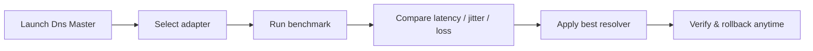

# Dns Master

<div align="center">


**A native Windows control deck for DNS resolvers — benchmark, switch, verify, and persist.**

[](https://github.com/alrzfrscn/Dns-Master/releases)
[](https://tauri.app)
[](https://www.rust-lang.org)
[](https://react.dev)
[](https://www.microsoft.com/windows)
[](LICENSE)

[](https://github.com/alrzfrscn/Dns-Master/releases)
[](https://github.com/alrzfrscn/Dns-Master/stargazers)
[](https://github.com/alrzfrscn/Dns-Master/issues)

**[⬇ Download the latest release](https://github.com/alrzfrscn/Dns-Master/releases)** · `.exe` installer · `.msi` package

</div>

---

## Why Dns Master?

| Before | After |
|:---|:---|
| Slow, unreliable DNS | Benchmarked, optimal resolvers |
| Manual `netsh` commands | One-click apply with rollback |
| Guessing which resolver is fastest | Real latency, jitter & packet loss |
| Sanctions blocking access | TLS SNI bypass verification |
| Settings lost on reboot | Atomic, persistent state |

---

## Feature Highlights

### 📡 Zero-CPU Win32 Live Telemetry
Per-adapter byte counters straight from `GetIfTable2`, streamed at 1 Hz with session totals and peak tracking. No sampling daemon, no console window, no background CPU burn.

### ⚡ RFC 1035 UDP:53 Parallel Benchmark
A real DNS benchmark over raw UDP:53 with a bounded 15-thread sweep. Latency, jitter and packet loss stream into the table as each probe finishes.

### 🛡️ TLS SNI Sanction Bypass Prober
Resolves six real targets (Docker Hub, GitHub, OpenAI, Hugging Face, Steam, EA), rejects sinkholes and bogons, then proves port 443 with a real ClientHello carrying the correct SNI.

### 🔍 Locale-Neutral Registry DNS Reader
Reads `Tcpip\Parameters\Interfaces\{GUID}` directly from the registry — no parsing of localized `netsh` output, so it works on every Windows language.

### 🔐 UAC-Safe Netsh Writer with Rollback
Applies resolvers hidden and unelevated, retries through a UAC prompt only when Windows refuses, verifies the read-back before reporting success, and keeps the previous resolver for one-click rollback.

### 🖥️ System Tray & Community GitHub JSON Sync
Close-to-tray, quick engage, DHCP reset and cache flush from the tray menu. Pull community resolver lists from any HTTPS GitHub raw URL — pins and real measurements survive every sync.

### 💾 Atomic Persistent State
Custom resolvers, synced rows, pins, settings and the rollback snapshot live in `%APPDATA%\com.dnsmaster.desktop\state.json`, written through a temp file and rename so a crash never truncates it.

### 🔔 Native Notifications & JSON Import / Export
Desktop notices for applies, resets and syncs. Export your own `{ "servers": [...] }` manifest and import it back through the same validator the sync uses.

---

## Installation

1. Open **[GitHub Releases](https://github.com/alrzfrscn/Dns-Master/releases)**.
2. Download the installer for your machine:
   - **`.exe`** — NSIS setup, user-level install, no admin required.
   - **`.msi`** — WiX package for enterprise, administrative or silent deployment.
3. Run it. WebView2 is built into Windows 11; on Windows 10 the installer pulls it in.

> Requires Windows 10/11 x64. Built with Tauri 2, so the download is small and the UI is native-fast.

---

## Quick Start



1. **Launch** Dns Master from the Start Menu or the tray.
2. **Select** your active network adapter.
3. **Benchmark** every resolver with one click.
4. **Review** and sort by latency, jitter or packet loss.
5. **Apply** the winner — the previous DNS is kept for rollback.
6. **Persist** your preferences in Settings.

---

## Community Resolver List

The default sync URL points at this repository's [`dns_list.json`](dns_list.json), so **SYNC NOW** works out of the box:

```
https://raw.githubusercontent.com/alrzfrscn/Dns-Master/main/dns_list.json
```

The manifest is a versioned `{ "version": 1, "servers": [...] }` document. Each entry:

```json
{
  "id": "electro",
  "name": "Electro",
  "nameFa": "الکترو",
  "provider": "Electro",
  "primary": "78.157.42.100",
  "secondary": "78.157.42.101",
  "category": "gaming",
  "tags": ["gaming", "low-ping", "iran"],
  "description": "Low-latency gaming resolver"
}
```

| Field | Required | Type | Notes |
|-------|:--------:|------|-------|
| `id` | ✅ | `string` | Unique slug |
| `name` | ✅ | `string` | Display name |
| `primary` | ✅ | `IPv4` | Must not be `0.0.0.0` |
| `secondary` | ❌ | `IPv4` | Empty string allowed |
| `nameFa` | ❌ | `string` | Persian display name |
| `provider` | ❌ | `string` | Provider / organization |
| `category` | ❌ | `enum` | `gaming` · `sanction` · `security` · `general` |
| `tags` | ❌ | `string[]` | Filterable tags |
| `description` | ❌ | `string` | Human-readable note |

Validation is strict: one invalid entry rejects the whole manifest, duplicate primaries collapse (first wins), and sync is HTTPS-only.

### Add your resolver

1. Fork this repository.
2. Add or edit an entry in [`dns_list.json`](dns_list.json) — gaming, low-ping or sanction-bypass resolvers are welcome.
3. Keep the JSON valid and the `primary` address unique.
4. Open a Pull Request describing the resolver and where it is useful.

Community lists can also be hosted anywhere public and pasted into **Settings → Resolver Source**.

---

## Development

### Prerequisites

- Windows 10/11 x64
- Node.js 20+
- Rust 1.77.2+ with the MSVC toolchain (`rustup default stable-msvc`)
- WebView2 Runtime

```powershell
git clone https://github.com/alrzfrscn/Dns-Master.git
cd Dns-Master
npm install

npm run dev          # Vite UI only
npm run tauri:dev    # full native shell
npm run build        # type-check + production frontend
npm run tauri:build  # Windows .exe / .msi installers
cargo test --manifest-path src-tauri/Cargo.toml
```

### Project Layout

```
Dns-Master/
├── src/                 # React 19 + TypeScript UI
├── src-tauri/           # Rust backend (Tauri 2)
│   └── src/
│       ├── platform.rs  # Win32 registry, netsh, traffic, curl
│       ├── dns.rs       # UDP:53 benchmark & TLS SNI probe
│       ├── sync.rs      # GitHub manifest sync
│       ├── store.rs     # Atomic state persistence
│       └── autostart.rs # HKCU Run key
├── dns_list.json        # Community resolver manifest
├── docs/ARCHITECTURE.md # Architecture & engineering log
└── .github/workflows/   # CI and tagged releases
```

See [`docs/ARCHITECTURE.md`](docs/ARCHITECTURE.md) for the full command contracts, state model and engineering log.

---

## Security & Privacy

- **No telemetry** — zero analytics, zero phone-home.
- **Local-only state** — everything stays in `%APPDATA%`.
- **HTTPS-only sync** — redirects cannot downgrade to `http` or `file`.
- **Strict manifests** — malformed lists are rejected before they touch your system.
- **UAC-aware** — never elevates silently.
- **Open source** — read and audit every line.

---

## Contributing

Pull requests are welcome — resolver entries, localization, themes, DoH/DoT support, Windows integration tests and packaging manifests.

```powershell
npm run build
cargo test --manifest-path src-tauri/Cargo.toml
```

Use conventional commit messages (`feat:`, `fix:`, `docs:`, `chore:`).

---

## License

MIT — see [LICENSE](LICENSE).

---

<div dir="rtl">

## نمای کلی فارسی

**Dns Master** یک جعبه‌ابزار بومی ویندوز برای مدیریت و سنجش DNS است: رزولورها را با بنچمارک واقعی UDP:53 مقایسه می‌کند، بهترین را با یک کلیک اعمال می‌کند و تنظیمات قبلی را برای بازگردانی نگه می‌دارد.

- 📡 **تلمتری زنده Win32** — آمار ترافیک هر آداپتور با مصرف پردازنده نزدیک به صفر
- ⚡ **بنچمارک موازی RFC 1035** — تأخیر، جیتر و افت بسته به‌صورت زنده
- 🛡️ **آزمایشگر عبور از تحریم TLS SNI** — بررسی واقعی اتصال ۴۴۳ به سرویس‌های تحریم‌شده
- 🔍 **خواندن DNS از رجیستری** — مستقل از زبان ویندوز
- 🔐 **نوشتن امن با UAC و بازگردانی** — اعمال، تأیید و برگشت با یک کلیک
- 🔄 **همگام‌سازی لیست از GitHub** — دریافت لیست جامعه از آدرس HTTPS

### نصب

از صفحهٔ **[Releases](https://github.com/alrzfrscn/Dns-Master/releases)** فایل نصب `.exe` یا `.msi` را دانلود کنید. ویندوز ۱۰ و ۱۱ (۶۴ بیتی) پشتیبانی می‌شود.

### مشارکت در لیست DNS

اگر DNS گیمینگ، کم‌تأخیر یا مناسب عبور از تحریم می‌شناسید:

1. مخزن را Fork کنید.
2. رزولور جدید را به فایل [`dns_list.json`](dns_list.json) اضافه کنید.
3. مقدار `primary` باید یک IPv4 معتبر و یکتا باشد.
4. یک Pull Request با توضیح کاربرد رزولور باز کنید.

لیست پیش‌فرض برنامه به همین فایل در شاخهٔ `main` متصل است، بنابراین تغییر شما پس از ادغام برای همهٔ کاربران با زدن **SYNC NOW** قابل دریافت است.

</div>

---

<div align="center">

**Built with ❤️ for Windows users who want control over their DNS.**

[⭐ Star this repo](https://github.com/alrzfrscn/Dns-Master) · [🐛 Report a bug](https://github.com/alrzfrscn/Dns-Master/issues/new) · [⬇ Releases](https://github.com/alrzfrscn/Dns-Master/releases)

</div>
