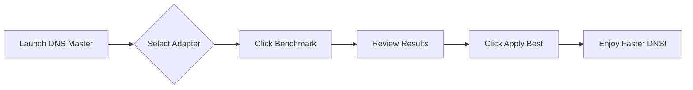
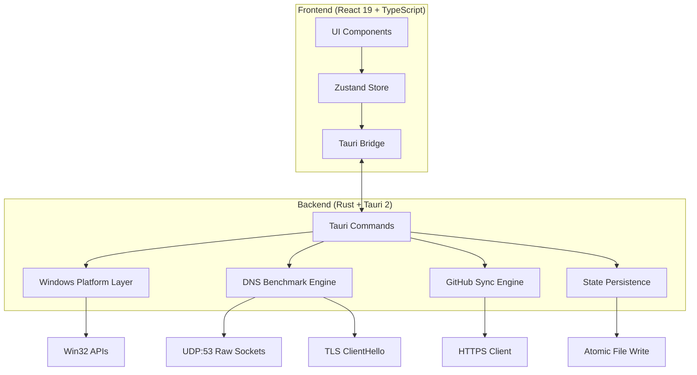

# DNS Master

<div align="center">


**A native Windows control deck for DNS resolvers — benchmark, switch, verify, and persist.**

[](https://github.com/alrzfrscn/Dns-Master/releases)
[](https://github.com/alrzfrscn/Dns-Master/releases)
[](https://github.com/alrzfrscn/Dns-Master/stargazers)
[](LICENSE)

[](https://www.microsoft.com/windows)
[](https://tauri.app)
[](https://www.rust-lang.org)
[](https://react.dev)

[](https://github.com/alrzfrscn/Dns-Master/releases/latest)
[](https://t.me/ImGr8)
[](https://github.com/alrzfrscn/Dns-Master/issues)

</div>
---

## ✨ Why DNS Master?

<div align="center">

| Before DNS Master | After DNS Master |
|:---:|:---:|
| 🐌 Slow, unreliable DNS | ⚡ Benchmarked, optimal resolvers |
| 🔧 Manual `netsh` commands | 🖱️ One-click apply with rollback |
| ❓ Guessing which resolver is fastest | 📊 Real-time latency, jitter & loss |
| 🌐 Sanctions blocking access | 🛡️ TLS SNI bypass verification |
| 💾 Settings lost on reboot | 🔒 Persistent across restarts |

</div>

---

## 🚀 Features

### 📡 **Live Traffic Telemetry**
Real-time per-adapter byte counters via `GetIfTable2`, streamed at 1Hz with session totals and peak tracking. No sampling daemon, no console window.

### ⚡ **Parallel DNS Benchmark**
RFC 1035 UDP:53 benchmark with bounded 15-thread sweep. Per-resolver latency, jitter, and packet loss — streamed into the table as each probe finishes.

### 🛡️ **TLS SNI Sanction Bypass Prober**
Resolves 6 real targets (Docker Hub, GitHub, OpenAI, Hugging Face, Steam, EA), rejects sinkholes and bogons, then proves port 443 with a real ClientHello carrying the correct SNI.

### 🔍 **Locale-Neutral Registry Reader**
Reads `Tcpip\Parameters\Interfaces\{GUID}` directly — no parsing of localized `netsh` output.

### 🛡️ **UAC-Safe Writer with Rollback**
Applies resolvers hidden and unelevated. Retries through UAC prompt only when Windows refuses. Verifies read-back before reporting success. Keeps previous resolver for one-click rollback.

### 💾 **Persistent State**
Custom resolvers, GitHub-synced rows, pins, settings, and rollback snapshot live in `%APPDATA%\com.dnsmaster.desktop\state.json`, written atomically.

### 🪟 **Real Windows Startup**
*Launch with Windows* toggle writes/removes `HKCU\Software\Microsoft\Windows\CurrentVersion\Run\DnsMaster`, launching with `--minimized` — no window on boot.

### 📦 **System Tray & Close-to-Tray**
Left-click restores; menu offers show/hide, quick engage, DHCP reset, cache flush, and real quit. Closing window hides it when *Minimize to tray* is enabled.

### 📤 **JSON Import / Export**
Export custom and pinned resolvers as `{ "servers": [...] }` manifest. Import any local manifest through the same validator the sync uses.

### 🔔 **Desktop Notifications**
Native notices for applies, resets, and syncs when the window is in the background.

### 🔄 **GitHub Raw JSON Sync**
HTTPS-only fetch, manifest validation, merge by primary IPv4. Real measurements and pins survive a pull.

---

## 📸 Screenshots

<div align="center">

| Main Dashboard | Benchmark Panel | Settings |
|:---:|:---:|:---:|
|  |  |  |
| *Real-time traffic & resolver status* | *Parallel latency, jitter & loss* | *Resolver source, sync & preferences* |

| System Tray | Custom DNS Modal | Network Tools |
|:---:|:---:|:---:|
|  |  |  |
| *Quick actions from tray* | *Add/edit custom resolvers* | *Flush cache, reset DHCP, test connectivity* |

</div>

---

## 📦 Installation

### Option 1: Modern Setup Installer (Recommended)
1. Go to [Releases](https://github.com/alrzfrscn/Dns-Master/releases/latest)
2. Download **`Dns.Master_1.0.0_x64-setup.exe`**
3. Run installer — no admin required for user-level install

### Option 2: Windows Installer (MSI)
1. Download **`Dns.Master_1.0.0_x64_en-US.msi`** from [Releases](https://github.com/alrzfrscn/Dns-Master/releases/latest)
2. Suitable for enterprise, administrative, or silent network deployment

### Option 3: Package Managers *(Coming Soon)*
```powershell
# Winget (coming soon)
winget install alrzfrscn.dns-master

# Scoop (coming soon)
scoop install dns-master
```

---

## 🎯 Quick Start



1. **Launch** DNS Master from Start Menu or tray
2. **Select** your active network adapter (top dropdown)
3. **Benchmark** — click the ▶ Benchmark button to test all resolvers
4. **Review** — sort by latency, jitter, or packet loss
5. **Apply** — click **Apply** on your chosen resolver
6. **Persist** — enable *Launch with Windows* & *Minimize to tray* in Settings

---

## 🌐 Custom Resolver List on GitHub

Host your own curated resolver list and sync it across machines.

### Create Your List

```json
{
  "version": 1,
  "servers": [
    {
      "id": "electro",
      "name": "Electro",
      "nameFa": "الکترو",
      "provider": "Electro",
      "primary": "78.157.42.100",
      "secondary": "78.157.42.101",
      "category": "gaming",
      "tags": ["gaming", "low-ping"],
      "description": "Low-latency gaming resolver"
    },
    {
      "id": "shecan",
      "name": "Shecan",
      "nameFa": "شکن",
      "provider": "Shecan",
      "primary": "178.22.122.100",
      "secondary": "185.51.200.2",
      "category": "sanction",
      "tags": ["sanction-bypass", "iran"],
      "description": "Sanction bypass for Iranian users"
    }
  ]
}
```

### Field Reference

| Field | Required | Type | Description |
|-------|:--------:|------|-------------|
| `id` | ✅ | `string` | Unique identifier (slug) |
| `name` | ✅ | `string` | Display name |
| `nameFa` | ❌ | `string` | Persian display name |
| `provider` | ❌ | `string` | Provider/organization name |
| `primary` | ✅ | `IPv4` | Primary DNS server (not `0.0.0.0`) |
| `secondary` | ❌ | `IPv4` | Secondary DNS server |
| `category` | ❌ | `enum` | `gaming` \| `sanction` \| `security` \| `general` |
| `tags` | ❌ | `string[]` | Filterable tags |
| `description` | ❌ | `string` | Human-readable description |

### Validation Rules
- `name` is required
- `primary` must be valid IPv4 ≠ `0.0.0.0`
- `secondary` may be empty or valid IPv4
- `category` normalized to one of four values
- Duplicate primaries collapse (first wins)
- **One invalid entry rejects the entire manifest**

### Sync Setup

1. **Export** — Settings → Resolver Source → Export JSON → save as `dns_list.json`
2. **Commit** — Push to a **public** GitHub repository
3. **Get Raw URL** — e.g., `https://raw.githubusercontent.com/alrzfrscn/Dns-Master/main/dns_list.json`
4. **Paste & Sync** — Settings → Resolver Source → paste URL → click **Sync**

> 💡 **Tip:** Pin resolvers before export to preserve them across syncs. Pins and real measurements survive a pull.

---

## ⚙️ Configuration

### State File Location
```
%APPDATA%\com.dnsmaster.desktop\state.json
```

### Schema
```json
{
  "customServers": [],
  "pinnedIds": [],
  "settings": {
    "launchOnStartup": false,
    "minimizeToTray": true,
    "closeToTray": true,
    "benchmarkThreads": 15,
    "benchmarkTimeoutMs": 2000,
    "resolverSourceUrl": "",
    "theme": "system"
  },
  "rollbackSnapshot": null,
  "lastSync": null
}
```

### CLI Arguments
| Argument | Description |
|----------|-------------|
| `--minimized` | Start minimized to tray (used by Windows startup) |
| `--benchmark` | Run benchmark on startup, output JSON to stdout |
| `--apply <id>` | Apply resolver by ID, exit on completion |
| `--reset-dhcp` | Reset adapter to DHCP, exit |
| `--flush-cache` | Flush DNS cache, exit |

---

## 🛠️ Development

### Prerequisites
- **Windows 10/11** (x64)
- **Node.js 20+** ([fnm](https://github.com/Schniz/fnm) or [nvm](https://github.com/coreybutler/nvm-windows) recommended)
- **Rust 1.77.2+** with MSVC toolchain (`rustup default stable-msvc`)
- **WebView2 Runtime** (built into Windows 11; [installer](https://go.microsoft.com/fwlink/p/?LinkId=2124703) for Windows 10)

### Setup
```powershell
# Clone
git clone https://github.com/alrzfrscn/Dns-Master.git
cd Dns-Master

# Install dependencies
npm install

# Development (UI only - simulated data)
npm run dev

# Development (Full native shell)
npm run tauri dev

# Type check
npx tsc --noEmit

# Rust tests
cargo test --manifest-path src-tauri/Cargo.toml
```

### Project Structure
```
dns-master/
├── src/                    # React frontend
│   ├── components/         # UI components
│   │   ├── ui/             # Base components (Toggle, Toast, GlassCard, etc.)
│   │   ├── dns/            # DNS-specific (BenchmarkPanel, CustomDnsModal, etc.)
│   │   ├── layout/         # Layout (Header, Sidebar, StatusBar, Ambient)
│   │   ├── settings/       # SettingsView
│   │   └── tools/          # NetworkTools
│   ├── store/              # Zustand store (AppStore.tsx)
│   ├── lib/                # Utilities (tauri.ts, format.ts, cn.ts)
│   ├── data/               # Static data (servers.ts, mock.ts, defaultDns.json)
│   ├── types/              # TypeScript types (network.ts)
│   ├── App.tsx             # Root component
│   └── main.tsx            # Entry point
├── src-tauri/              # Rust backend
│   ├── src/
│   │   ├── main.rs         # Entry point
│   │   ├── lib.rs          # Tauri commands & plugin setup
│   │   ├── platform.rs     # Windows DNS/registry/netsh impl
│   │   ├── platform_stub.rs # Non-Windows stub
│   │   ├── dns.rs          # Benchmark & probe logic
│   │   ├── store.rs        # State persistence
│   │   ├── sync.rs         # GitHub sync logic
│   │   └── autostart.rs    # HKCU Run key management
│   ├── Cargo.toml
│   ├── tauri.conf.json
│   ├── build.rs
│   └── icons/              # App icons
├── assets/                 # Static assets (banner, screenshots)
├── dns_list.json           # Example resolver manifest
├── package.json
├── tsconfig.json
├── vite.config.ts
└── index.html
```

### Key Commands
```powershell
# Frontend only (Vite)
npm run dev

# Full Tauri dev
npm run tauri dev

# Production build
npm run tauri:build
# → src-tauri/target/release/bundle/

# Lint & format
npm run lint
npm run format

# Rust only
cargo check --manifest-path src-tauri/Cargo.toml
cargo clippy --manifest-path src-tauri/Cargo.toml
```

---

## 🏗️ Architecture



### Technology Choices

| Layer | Technology | Why |
|-------|------------|-----|
| **UI Framework** | React 19 + TypeScript | Modern, type-safe, excellent DX |
| **Styling** | Tailwind CSS + CSS Variables | Utility-first, theming, dark mode |
| **State** | Zustand | Minimal, fast, no boilerplate |
| **Native Shell** | Tauri 2 | Small bundle, Rust backend, secure |
| **DNS Benchmark** | Raw UDP sockets + `tokio` | True RFC 1035, no external deps |
| **TLS Probe** | `rustls` + custom ClientHello | Proves SNI without full handshake |
| **Persistence** | `serde_json` + atomic write | Crash-safe, human-readable |
| **Sync** | `reqwest` + JSON schema validation | HTTPS-only, fail-fast validation |

---

## 🔒 Security & Privacy

- **No telemetry** — zero data collection, no analytics
- **Local-only** — all data stays on your machine
- **HTTPS-only sync** — GitHub raw URLs fetched over TLS 1.2+
- **Manifest validation** — strict schema, rejects malformed lists
- **UAC-aware** — never elevates silently, always prompts
- **Open source** — audit the code yourself

### Permissions
| Permission | Purpose |
|------------|---------|
| Network (UDP:53) | DNS benchmark queries |
| Network (TCP:443) | TLS SNI probes & GitHub sync |
| Registry (HKCU) | Read/write DNS settings, startup |
| File System (`%APPDATA%`) | State persistence |
| System Tray | Background operation |

---

## 🤝 Contributing

### Quick Contribution Checklist
- [ ] Fork the repo
- [ ] Create feature branch (`git checkout -b feature/amazing-feature`)
- [ ] Run `npm run lint && npx tsc --noEmit && cargo clippy`
- [ ] Commit with conventional messages (`feat:`, `fix:`, `docs:`, etc.)
- [ ] Push and open PR

### Areas We'd Love Help
- 🌍 **Localization** — Persian is built-in; add more languages
- 🎨 **Themes** — More color schemes, high contrast
- 📊 **Benchmarks** — DoH/DoT support, IPv6
- 🧪 **Tests** — Integration tests for Windows platform layer
- 📦 **Packaging** — Scoop, Chocolatey, Winget manifests

---

## 📄 License

MIT License — see [LICENSE](LICENSE) for details.

```
MIT License

Copyright (c) 2024 DNS Master Contributors

Permission is hereby granted, free of charge, to any person obtaining a copy
of this software and associated documentation files (the "Software"), to deal
in the Software without restriction, including without limitation the rights
to use, copy, modify, merge, publish, distribute, sublicense, and/or sell
copies of the Software, and to permit persons to whom the Software is
furnished to do so, subject to the following conditions:

The above copyright notice and this permission notice shall be included in all
copies or substantial portions of the Software.

THE SOFTWARE IS PROVIDED "AS IS", WITHOUT WARRANTY OF ANY KIND, EXPRESS OR
IMPLIED, INCLUDING BUT NOT LIMITED TO THE WARRANTIES OF MERCHANTABILITY,
FITNESS FOR A PARTICULAR PURPOSE AND NONINFRINGEMENT. IN NO EVENT SHALL THE
AUTHORS OR COPYRIGHT HOLDERS BE LIABLE FOR ANY CLAIM, DAMAGES OR OTHER
LIABILITY, WHETHER IN AN ACTION OF CONTRACT, TORT OR OTHERWISE, ARISING FROM,
OUT OF OR IN CONNECTION WITH THE SOFTWARE OR THE USE OR OTHER DEALINGS IN THE
SOFTWARE.
```

---

## 🙏 Acknowledgments

- [Tauri](https://tauri.app) — For the incredible native framework
- [React](https://react.dev) — For the UI library we love
- [Rust](https://www.rust-lang.org) — For fearless concurrency
- [Tailwind CSS](https://tailwindcss.com) — For utility-first styling
- [Zustand](https://github.com/pmndrs/zustand) — For bear-necessities state management
- [Lucide](https://lucide.dev) — For beautiful icons
- All contributors who make this project better ❤️

---

## 📞 Support & Community

| Channel | Purpose |
|---------|---------|
| [Telegram (@ImGr8)](https://t.me/ImGr8) | Direct chat, feedback & developer contact |
| [GitHub Issues](https://github.com/alrzfrscn/Dns-Master/issues) | Bug reports & feature requests |
| [Discussions](https://github.com/alrzfrscn/Dns-Master/discussions) | Questions, ideas, show & tell |
| [GitHub Releases](https://github.com/alrzfrscn/Dns-Master/releases) | Download latest executables & updates |

---

<div align="center">

**Made with ❤️ for Windows users who want control over their DNS**

[⭐ Star this repo](https://github.com/alrzfrscn/Dns-Master) • [🐛 Report Bug](https://github.com/alrzfrscn/Dns-Master/issues/new) • [💡 Request Feature](https://github.com/alrzfrscn/Dns-Master/issues/new) • [💬 Telegram](https://t.me/ImGr8)

</div>
