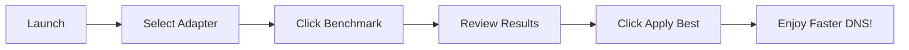
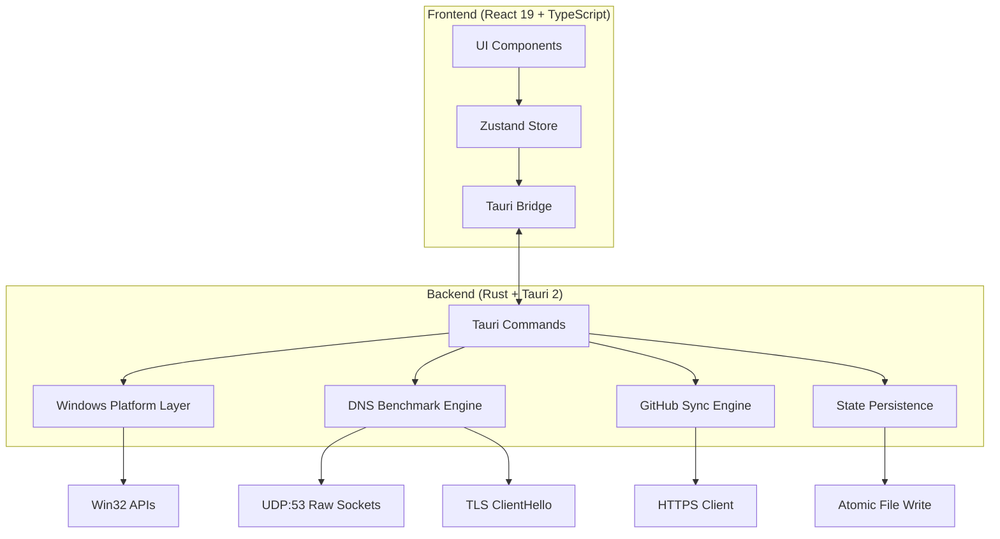

# DNS Master

<div align="center">


**A native Windows control deck for DNS resolvers — benchmark, switch, verify, and persist.**

[](https://github.com/yourusername/dns-master/actions)
[](https://github.com/yourusername/dns-master/releases)
[](LICENSE)
[](https://www.microsoft.com/windows)
[](https://tauri.app)
[](https://react.dev)
[](https://www.rust-lang.org)

[](https://github.com/yourusername/dns-master/releases/latest)
[](https://discord.gg/yourserver)
[](https://github.com/yourusername/dns-master/stargazers)

</div>

---

## ✨ Why DNS Master?

<div align="center">

| Before DNS Master | After DNS Master |
|:---:|:---:|
| 🐌 Slow, unreliable DNS | ⚡ Benchmarked, optimal resolvers |
| 🔧 Manual `netsh` commands | 🖱️ One-click apply with rollback |
| ❓ Guessing which resolver is fastest | 📊 Real-time latency, jitter & loss |
| 🌐 Sanctions blocking access | 🛡️ TLS SNI bypass verification |
| 💾 Settings lost on reboot | 🔒 Persistent across restarts |

</div>

---

## 🚀 Features

| Feature | Description |
|---------|-------------|
| **Live Traffic Telemetry** | Real-time per-adapter byte counters via `GetIfTable2`, streamed at 1Hz with session totals and peaks. No daemon, no console. |
| **Parallel DNS Benchmark** | RFC 1035 UDP:53 with bounded 15-thread sweep. Per-resolver latency, jitter, packet loss — streamed as probes finish. |
| **TLS SNI Sanction Bypass Prober** | Resolves 6 real targets (Docker Hub, GitHub, OpenAI, Hugging Face, Steam, EA), rejects sinkholes/bogons, proves port 443 with real ClientHello + correct SNI. |
| **Locale-Neutral Registry Reader** | Reads `Tcpip\Parameters\Interfaces\{GUID}` directly — no parsing localized `netsh` output. |
| **UAC-Safe Writer with Rollback** | Applies hidden/unelevated; retries via UAC only when refused. Verifies read-back before success. One-click rollback. |
| **Persistent State** | Custom resolvers, synced rows, pins, settings, rollback snapshot in `%APPDATA%\com.dnsmaster.desktop\state.json` (atomic writes). |
| **Real Windows Startup** | Toggle writes/removes `HKCU\...\Run\DnsMaster` with `--minimized` — no window on boot. |
| **System Tray & Close-to-Tray** | Left-click restores; menu: show/hide, quick engage, DHCP reset, cache flush, quit. |
| **JSON Import / Export** | Export/import `{ "servers": [...] }` manifests through the same validator sync uses. |
| **Desktop Notifications** | Native notices for applies, resets, syncs when window is backgrounded. |
| **GitHub Raw JSON Sync** | HTTPS-only fetch, manifest validation, merge by primary IPv4. Measurements & pins survive pull. |

---

## 📦 Installation

| Method | Steps |
|--------|-------|
| **Installer** (Recommended) | Download `DNS_Master_Setup_x64.exe` from [Releases](https://github.com/yourusername/dns-master/releases/latest) → run (no admin for user-level) |
| **Portable** | Download `dns-master_x64_portable.zip` from Releases → extract → run `dns-master.exe` |
| **Package Managers** | `scoop install dns-master` • `choco install dns-master` • `winget install yourusername.dns-master` *(coming soon)* |

---

## 🎯 Quick Start



1. **Launch** from Start Menu or tray
2. **Select** active network adapter (top dropdown)
3. **Benchmark** — click ▶ to test all resolvers
4. **Review** — sort by latency, jitter, or packet loss
5. **Apply** — click **Apply** on chosen resolver
6. **Persist** — enable *Launch with Windows* & *Minimize to tray* in Settings

---

## 🌐 Custom Resolver List (GitHub Sync)

Host your own curated list and sync across machines.

### Manifest Format
```json
{
  "version": 1,
  "servers": [
    {
      "id": "electro",
      "name": "Electro",
      "nameFa": "الکترو",
      "provider": "Electro",
      "primary": "78.157.42.100",
      "secondary": "78.157.42.101",
      "category": "gaming",
      "tags": ["gaming", "low-ping"],
      "description": "Low-latency gaming resolver"
    }
  ]
}
```

### Fields
| Field | Required | Type | Description |
|-------|:--------:|------|-------------|
| `id` | ✅ | `string` | Unique slug |
| `name` | ✅ | `string` | Display name |
| `nameFa` | ❌ | `string` | Persian name |
| `provider` | ❌ | `string` | Organization |
| `primary` | ✅ | `IPv4` | Primary DNS (≠ `0.0.0.0`) |
| `secondary` | ❌ | `IPv4` | Secondary DNS |
| `category` | ❌ | `enum` | `gaming` \| `sanction` \| `security` \| `general` |
| `tags` | ❌ | `string[]` | Filterable tags |
| `description` | ❌ | `string` | Human-readable |

### Validation
- `name` required, `primary` valid IPv4 ≠ `0.0.0.0`
- `secondary` empty or valid IPv4
- `category` normalized to 4 values
- Duplicate primaries collapse (first wins)
- **One invalid entry rejects entire manifest**

### Sync Setup
1. **Export** — Settings → Resolver Source → Export JSON → save as `dns_list.json`
2. **Commit** — Push to **public** GitHub repo
3. **Get Raw URL** — e.g., `https://raw.githubusercontent.com/user/repo/main/dns_list.json`
4. **Paste & Sync** — Settings → Resolver Source → paste URL → **Sync**

> 💡 Pin resolvers before export to preserve across syncs. Pins & measurements survive pull.

---

## ⚙️ Configuration

### State File
```
%APPDATA%\com.dnsmaster.desktop\state.json
```

### Schema
```json
{
  "customServers": [],
  "pinnedIds": [],
  "settings": {
    "launchOnStartup": false,
    "minimizeToTray": true,
    "closeToTray": true,
    "benchmarkThreads": 15,
    "benchmarkTimeoutMs": 2000,
    "resolverSourceUrl": "",
    "theme": "system"
  },
  "rollbackSnapshot": null,
  "lastSync": null
}
```

### CLI Arguments
| Argument | Description |
|----------|-------------|
| `--minimized` | Start minimized to tray (Windows startup) |
| `--benchmark` | Run benchmark on startup, output JSON |
| `--apply <id>` | Apply resolver by ID, exit |
| `--reset-dhcp` | Reset adapter to DHCP, exit |
| `--flush-cache` | Flush DNS cache, exit |

---

## 🛠️ Development

### Prerequisites
- Windows 10/11 (x64)
- Node.js 20+ ([fnm](https://github.com/Schniz/fnm) recommended)
- Rust 1.77.2+ with MSVC toolchain (`rustup default stable-msvc`)
- WebView2 Runtime (built into Win11; [installer](https://go.microsoft.com/fwlink/p/?LinkId=2124703) for Win10)

### Setup
```powershell
git clone https://github.com/yourusername/dns-master.git
cd dns-master
npm install

# UI only (simulated data)
npm run dev          # → http://localhost:1420

# Full native shell
npm run tauri dev

# Type check
npx tsc --noEmit

# Rust tests
cargo test --manifest-path src-tauri/Cargo.toml
```

### Key Commands
```powershell
npm run dev              # Frontend only
npm run tauri dev        # Full Tauri dev
npm run tauri:build      # Production build → src-tauri/target/release/bundle/
npm run lint && npm run format
cargo check --manifest-path src-tauri/Cargo.toml
cargo clippy --manifest-path src-tauri/Cargo.toml
```

---

## 🏗️ Architecture



### Technology Stack
| Layer | Technology | Rationale |
|-------|------------|-----------|
| UI Framework | React 19 + TypeScript | Modern, type-safe, excellent DX |
| Styling | Tailwind CSS 4 + CSS Variables | Utility-first, theming, dark mode |
| State | Zustand | Minimal, fast, no boilerplate |
| Native Shell | Tauri 2 | Small bundle, Rust backend, secure |
| DNS Benchmark | Raw UDP sockets + `tokio` | True RFC 1035, no external deps |
| TLS Probe | `rustls` + custom ClientHello | Proves SNI without full handshake |
| Persistence | `serde_json` + atomic write | Crash-safe, human-readable |
| Sync | `reqwest` + JSON validation | HTTPS-only, fail-fast validation |

---

## 🔒 Security & Privacy

- **No telemetry** — zero data collection, no analytics
- **Local-only** — all data stays on your machine
- **HTTPS-only sync** — GitHub raw URLs over TLS 1.2+
- **Manifest validation** — strict schema, rejects malformed lists
- **UAC-aware** — never elevates silently, always prompts
- **Open source** — audit the code yourself

### Permissions
| Permission | Purpose |
|------------|---------|
| Network (UDP:53) | DNS benchmark queries |
| Network (TCP:443) | TLS SNI probes & GitHub sync |
| Registry (HKCU) | Read/write DNS settings, startup |
| File System (`%APPDATA%`) | State persistence |
| System Tray | Background operation |

---

## 🤝 Contributing

We welcome contributions! See [Contributing Guide](CONTRIBUTING.md).

### Quick Checklist
- [ ] Fork → feature branch (`git checkout -b feature/amazing-feature`)
- [ ] Run `npm run lint && npx tsc --noEmit && cargo clippy`
- [ ] Conventional commits (`feat:`, `fix:`, `docs:`, etc.)
- [ ] Push & open PR

### Needed Help
- 🌍 **Localization** — Persian built-in; add more languages
- 🎨 **Themes** — More color schemes, high contrast
- 📊 **Benchmarks** — DoH/DoT support, IPv6
- 🧪 **Tests** — Integration tests for Windows platform layer
- 📦 **Packaging** — Scoop, Chocolatey, Winget manifests

---

## 📄 License

MIT License — see [LICENSE](LICENSE) for details.

---

## 🙏 Acknowledgments

- [Tauri](https://tauri.app) • [React](https://react.dev) • [Rust](https://www.rust-lang.org)
- [Tailwind CSS](https://tailwindcss.com) • [Zustand](https://github.com/pmndrs/zustand) • [Lucide](https://lucide.dev)
- All contributors ❤️

---

## 📞 Support

| Channel | Purpose |
|---------|---------|
| [GitHub Issues](https://github.com/yourusername/dns-master/issues) | Bug reports, feature requests |
| [Discussions](https://github.com/yourusername/dns-master/discussions) | Questions, ideas, show & tell |
| [Discord](https://discord.gg/yourserver) | Real-time chat, community |

---

<div align="center">

**Made with ❤️ for Windows users who want control over their DNS**

[⭐ Star this repo](https://github.com/yourusername/dns-master) • [🐛 Report Bug](https://github.com/yourusername/dns-master/issues/new?template=bug_report.md) • [💡 Request Feature](https://github.com/yourusername/dns-master/issues/new?template=feature_request.md)

</div>